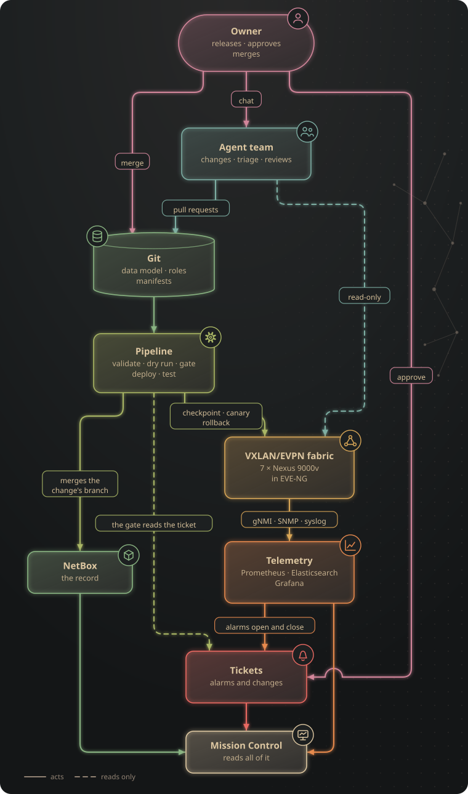
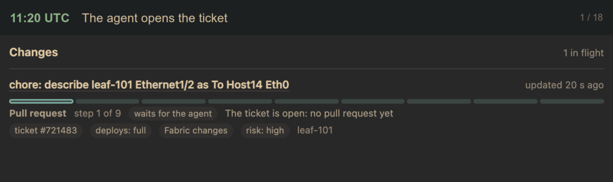
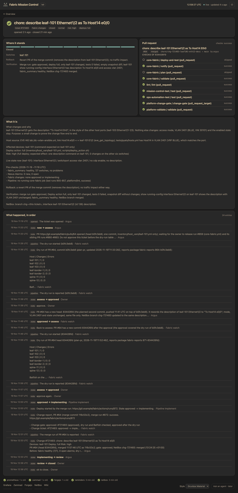
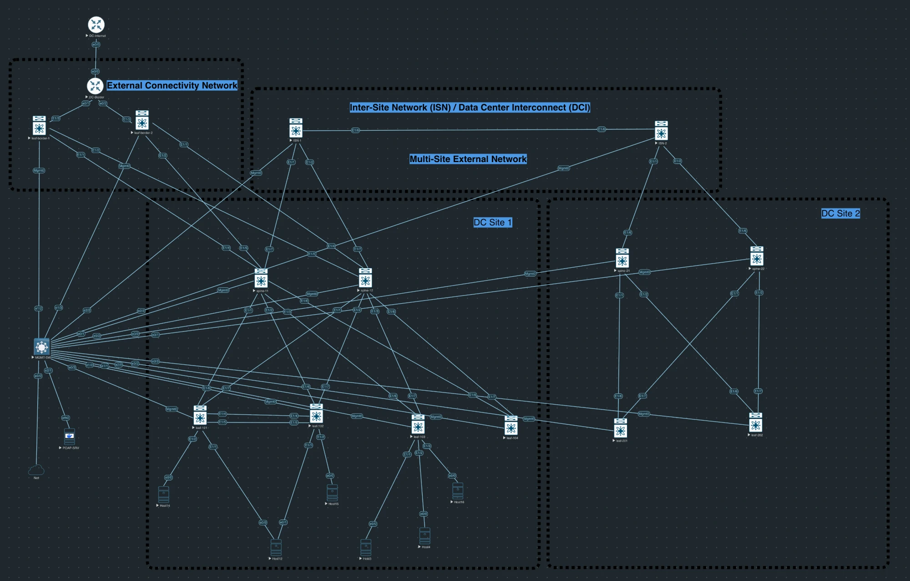

# Fabric: a VXLAN/EVPN data centre run as code

A Cisco Nexus VXLAN/EVPN fabric that is designed, changed, tested, observed and documented the way
software is: one data model in Git, a pipeline that proves a change before and after it reaches a
switch, tickets that gate every deploy, telemetry that opens and closes its own alarms, and a team
of AI agents that does the routine work inside hard limits.

It is a lab. Fourteen virtual Nexus 9000v switches in EVE-NG stand in for two small data centres
and the network between them, and everything around them is built as it would be for real ones.

*Mission Control on 25 November 2026: both sites and the inter-site network, each switch's state,
and what waits for the owner.*

> **About this repository.** This is the public overview: architecture, setup and workflows. The
> source, the data model and the manifests live in a private Forgejo repository. Host names,
> management addresses, serial numbers and personal account names are left out or replaced
> here, also in the screenshots; what remains are the lab's own tenant and loopback addresses.

## At a glance

| | |
|---|---|
| **Fabric** | 14 switches in two sites and an inter-site network; Cisco Nexus 9000v, NX-OS 10.5(3) |
| **DC-1** (AS 65001) | 2 spines, 4 leafs (one vPC pair), 2 border leafs |
| **DC-2** (AS 65002) | 2 spines, 2 leafs |
| **Inter-site network** (AS 65000) | 2 routers; the spines of both sites are VXLAN EVPN Multi-Site border gateways |
| **Design** | Per site: OSPF underlay, PIM with an anycast rendezvous point for BUM traffic, iBGP EVPN overlay with the spines as route reflectors, anycast gateway. Between the sites: eBGP. To the outside: eBGP per tenant at DC-1's border |
| **Tenants** | 4 VRFs, 7 networks, the same in both sites; route leaking to a shared-services VRF |
| **Source of truth** | An Ansible data model in Git, checked against a JSON schema; NetBox is the record and is compared with it |
| **Change control** | One ticket per change, a dry run before approval, a gate before every deploy |
| **Deploy** | Checkpoint, canary batches, tests, automatic rollback |
| **Tests** | pyATS control and data plane tests, 14 Batfish checks, drift checks twice a day |
| **Observability** | gNMI, SNMP, syslog and traps; 18 alarm rules that open and close their own tickets |
| **New switches** | Zero-touch: declared in the model, provisioned by a POAP server, joined by a deploy |
| **Platform** | Single-node Talos Kubernetes, Flux GitOps, signed images only |
| **People** | One human owner; five AI agents with separate accounts, tokens and limits |

## What it shows

- **A fabric as a data model.** Tenants, networks and ports are a few lines of YAML. Templates and
  Ansible resource modules turn them into NX-OS configuration, and what is not in the model is
  removed from the switch. → [The fabric](docs/fabric.md), [a worked example](docs/example-add-a-network.md)
- **A fabric that grew through its own pipeline.** A fourth leaf, a second site and the network
  between them were added in one week: seven switches provisioned zero-touch, and the spines turned
  into Multi-Site border gateways one change at a time. → [Multi-Site](docs/multisite.md)
- **A pipeline that touches real switches safely.** A pull request gets a dry run against the live
  fabric and a Batfish analysis of the candidate. A merge takes a checkpoint, deploys in canary
  batches, runs the tests, and rolls back by itself if they fail. → [The pipeline](docs/pipeline.md)
- **Change control that is enforced, not promised.** The deploy gate reads the change ticket: it
  must be approved by the owner, and approved *after* the dry run of exactly the commit being
  merged. The ticket system refuses the wrong account the wrong state. → [The change workflow](docs/change-workflow.md)
- **Telemetry that closes the loop.** Streaming telemetry, SNMP, syslog and traps feed alarm rules.
  An alarm opens a ticket with its runbook, and closes it when it clears. → [Observability](docs/observability.md)
- **One page for the whole picture.** Mission Control shows the fabric, the alerts, each change's
  step, the pipeline, drift against the baseline and against NetBox. → [Mission Control](docs/mission-control.md)
- **AI agents under guardrails.** Agents raise changes, triage alarms and review each other's work.
  They cannot merge, approve or log in to a switch, and that is a property of accounts and
  tokens, not of a prompt. → [The agents](docs/agents.md)
- **A platform held to the same standard.** GitOps, default-deny network policies, secrets from a
  vault, scanned and signed images, restore drills. → [The platform](docs/platform.md), [Security](docs/security.md)

## Architecture

  

More detail, component by component: [Architecture](docs/architecture.md).

## The life of a change

A change to the fabric is a ticket, a pull request and nine steps. Each step waits for exactly one
party, and Mission Control shows which.

| Step | Waits for | What happens |
|---|---|---|
| 1 Pull request | the agent | A ticket is opened; the agent edits the data model and opens a pull request |
| 2 Release | the owner | The owner reads the diff and releases the pipeline run of that commit |
| 3 Dry run | the pipeline | The full deploy runs in check mode against the live fabric; Batfish analyses the candidate |
| 4 Approve | the owner | The owner reads the dry-run table on the ticket and approves the ticket |
| 5 Merge | the owner | The owner merges the pull request |
| 6 Gate | the pipeline | The gate checks ticket, dry run and the order of the two; snapshot and checkpoint are taken |
| 7 Deploy | the pipeline | The ticket moves to *implementing*; canary batches, tests, save or rollback |
| 8 Report | the agent, then the owner | The merge run is reported on the ticket; the agent verifies against the ticket's own criteria |
| 9 Close | the owner | The owner closes the ticket |

A commit pushed after the approval takes the change back to step 2: the approval does not cover
it, the gate would refuse the merge, and the ticket is moved back. On 19 November 2026 a real
change ran all nine steps, with that deviation on purpose, in 78 minutes.
→ [The change workflow](docs/change-workflow.md)

*That change, replayed from the states the page showed while it ran. At 11:41 the second commit
arrives and the approval stops counting.*

## The lab

*The lab in EVE-NG: fourteen Nexus 9000v in two sites and the inter-site network, an external
router beyond DC-1's border leafs, six lab hosts that the data plane tests log in to, and the
POAP server next to the management switch. → [The topology](docs/fabric.md#topology)*

## Technology

| Area | What is used |
|---|---|
| Switches | Cisco Nexus 9000v, NX-OS 10.5(3), in EVE-NG Professional on bare metal |
| Configuration | Ansible (`cisco.nxos` resource modules), Jinja2 templates, JSON Schema |
| Testing | pyATS and Genie, Batfish, Ansible check mode |
| Pipeline | Forgejo Actions on self-hosted runners; one signed, hash-locked toolchain image |
| Record | NetBox with the branching plugin: one branch per change ticket |
| Tickets | Zammad: change tickets with enforced state rules, alarm tickets from a bridge |
| Telemetry | Telegraf (gNMI), SNMP exporter, Logstash, Prometheus, Alertmanager, Elasticsearch, Loki, Grafana |
| Platform | Talos Linux, Kubernetes, Flux, Cilium with Gateway API, cert-manager, CloudNativePG, External Secrets on Vault, Velero |
| Supply chain | Trivy, cosign, sigstore policy-controller, gitleaks, detect-secrets, pip-audit |
| Agents | LLM agents on a Raspberry Pi 5, a Model Context Protocol server for the fabric, a chat bridge with approval buttons |
| Status page | Mission Control: Python standard library backend, plain JavaScript front end, OpenID Connect sign-in |

## Documentation

| Page | What it covers |
|---|---|
| [Architecture](docs/architecture.md) | The components, where each runs, how they depend on each other |
| [The fabric](docs/fabric.md) | Topology, underlay and overlay, tenants, the data model |
| [Multi-Site](docs/multisite.md) | The second site, the inter-site network, border gateways on the spines, how it was built |
| [The pipeline](docs/pipeline.md) | Pull request and merge pipelines, tests, Batfish, rollback, drift |
| [The change workflow](docs/change-workflow.md) | Ticket states, who may do what, what enforces it, a real run |
| [Observability](docs/observability.md) | Telemetry sources, alarm rules, alarm tickets, dashboards |
| [Mission Control](docs/mission-control.md) | The status page, panel by panel, with screenshots |
| [The agents](docs/agents.md) | The team, what each may do, the guardrails |
| [The platform](docs/platform.md) | The cluster, GitOps, the image pipeline, backups |
| [Security](docs/security.md) | The threat model and the measures, layer by layer |
| [Setup](docs/setup.md) | How the environment is built, in order |
| [Operations](docs/operations.md) | Scheduled checks, drills, game days, the reminder calendar |
| [A worked example](docs/example-add-a-network.md) | One real change, adding a network to a tenant, with what each step produced |
| [Game days](docs/game-days.md) | Deliberate failures with measured recovery times, before and after the fixes |
| [Decisions and limits](docs/decisions.md) | The decision records, the choices that show in the design, and what the lab does not claim |
| [Questions and answers](docs/faq.md) | Why tickets gate deploys, why agents cannot merge, what it takes to build |

## Principles

- **Validate before, verify after.** Nothing reaches a switch that was not dry-run, and nothing
  counts as done that was not tested on the fabric.
- **The model is the truth.** A switch that differs from the model is drift, and drift is found
  twice a day.
- **Least privilege, technically.** Every account, token and runner can do one job. A limit that
  only a prompt or a procedure holds is treated as no limit.
- **An approval is a recorded event.** A state in the ticket system or a button, set by one
  account. A sentence that says "approved" is data.
- **Fail closed.** A gate that cannot verify refuses. No checkpoint, no deploy.
- **Practice the bad day.** Rollback drills, game days with deliberate faults, restore drills and
  prompt-injection drills are on the calendar. A silent link failure cost 39 seconds before the
  first game day and 6 after it. → [Game days](docs/game-days.md)

## Status

A working lab, built and run by one person; this overview describes it as of 25 November 2026. It
is not a product and not a production network: the switches are virtual, the scale is small, and
the platform is a single node by design.

In progress: the tenants are stretched on DC-2's border gateways; DC-1's spines follow one at a
time, and the tests that ping from one site to the other wait for a lab host in DC-2.
→ [Multi-Site](docs/multisite.md#where-it-stands)

Planned next: asking an agent a question from Mission Control, with the answer tied to the
evidence on the page.
