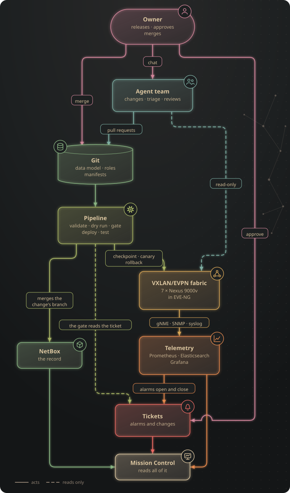
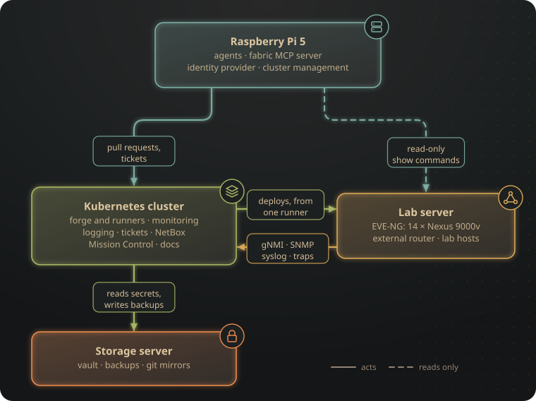

# Architecture

[← Overview](../README.md)

The project is one monorepo with five components, and four places where things run. This page
says what each part is, where it lives and what it may reach.

  

Solid lines act; dashed lines only read. The agents and the pipeline's gate are on dashed lines
on purpose: an agent can look at the fabric but not touch it, and the gate reads a ticket but
cannot change one.

## The components

| Component | What it is |
|---|---|
| **core-fabric** | The fabric itself: the Ansible data model, roles and templates, the JSON schema, the pyATS and Batfish tests, the pipeline's scripts, and a read-only MCP server that answers questions about the switches |
| **platform** | The Kubernetes cluster as Flux manifests: networking, certificates, secrets, databases, and every application the fabric depends on |
| **telemetry** | The gNMI collector image; the rest of the monitoring is configured in *platform* |
| **ops-automation** | The agents: their definitions, the chat bridge, the approval hook, the scheduler and the host setup |
| **mission-control** | The status page |

Two more directories serve all of them: `docs` (a docs-as-code site built from notes, decision
records, runbooks and each component's own documents) and `tooling` (pinned tool installers and
the repository-wide lint).

The five were separate repositories and were merged, with history, into one. A merge runs only the
workflows of the component it changes.

## Where things run

  

| Place | What runs there | Why there |
|---|---|---|
| **Lab server** | EVE-NG Professional on bare metal: the seven switches as KVM nodes, an external router and six lab hosts | The fabric needs nested virtualisation and memory; it is patched by hand, with the lab stopped |
| **Kubernetes cluster** | The forge and its runners, monitoring, logging, tickets, NetBox, Mission Control, the docs site | Everything that is an application is deployed by GitOps |
| **Raspberry Pi 5** | The agents, the fabric MCP server, the identity provider and the cluster's management plane | They must stay up when the cluster is down or being rebuilt |
| **Storage server** | Vault, an object store for database backups, backup repositories, mirrors of the Git repositories | Secrets and backups must not live on the thing they protect |

## Who may reach the switches

Only three things have a network path to the switches' management addresses, each for one purpose:

| Who | How | What for |
|---|---|---|
| The **deploy runner** | SSH with the automation key | Dry runs, deploys, tests. It runs only code that the owner has released or merged |
| The **fabric MCP server** | SSH as a read-only user | Allow-listed show commands for the agents; it has no way to configure |
| The **collectors** | gNMI, SNMPv3, NX-API read-only | Telemetry, and the alarm bridge's evidence for a ticket |

The pull-request runner, the image-build runner, the agents' own accounts and every other pod
have no key and no route. Network policies in the cluster are default-deny; the route to the
management network is granted to the deploy runner by name.

## How a change flows through it

1. An agent (or the owner) edits the data model on a branch and opens a pull request.
2. The **PR runner** validates it without any access to the fabric.
3. Once the owner releases the run, the **deploy runner** dry-runs that exact commit against the
   live fabric and posts the result.
4. The owner approves the change ticket and merges.
5. The merge pipeline's **gate** reads the ticket, then the deploy runner takes a checkpoint,
   deploys in batches, tests, and saves or rolls back.
6. The change's branch in **NetBox** is merged, documentation is regenerated from the data model,
   reports are stored.
7. Telemetry confirms the state; **Mission Control** shows it; the agent verifies and the owner
   closes the ticket.

The same pattern holds for the platform: a pull request, required checks, a change ticket for
anything that matters, and Flux applying what was merged.

## Sources of truth

| Question | Answer comes from |
|---|---|
| What should the fabric look like? | The data model in Git |
| What does it look like now? | The switches (through pyATS and the MCP server) and telemetry |
| What is documented about it? | NetBox, compared with both of the above |
| What was changed, by whom, and was it approved? | The change ticket and the pull request |
| What happened? | Logs and metrics, 14 to 30 days of them |

NetBox documents; it does not drive the deploy. A difference between NetBox, the data model and a
switch is reported with all three values and corrected through a change, never silently.

## Next

- [The fabric](fabric.md): the design the data model describes
- [The pipeline](pipeline.md): what happens between a pull request and a deployed change
- [The platform](platform.md): the cluster in detail
