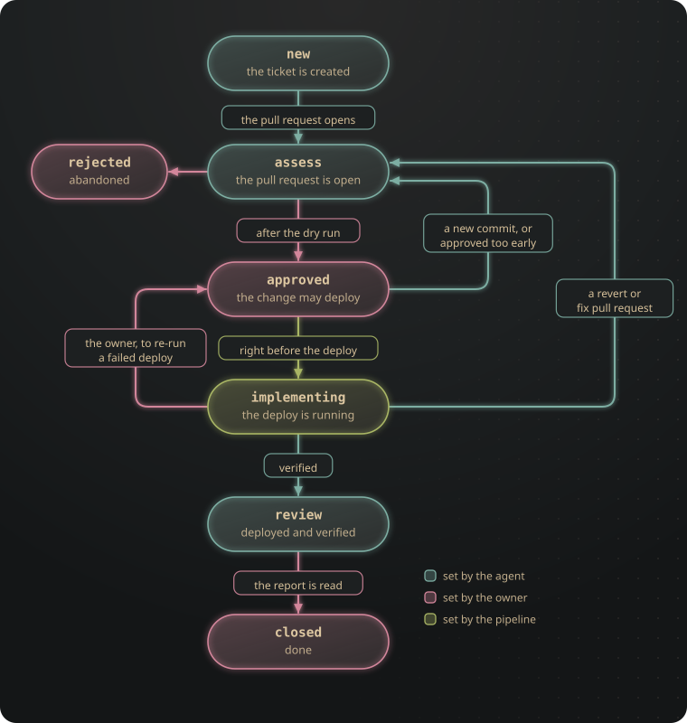
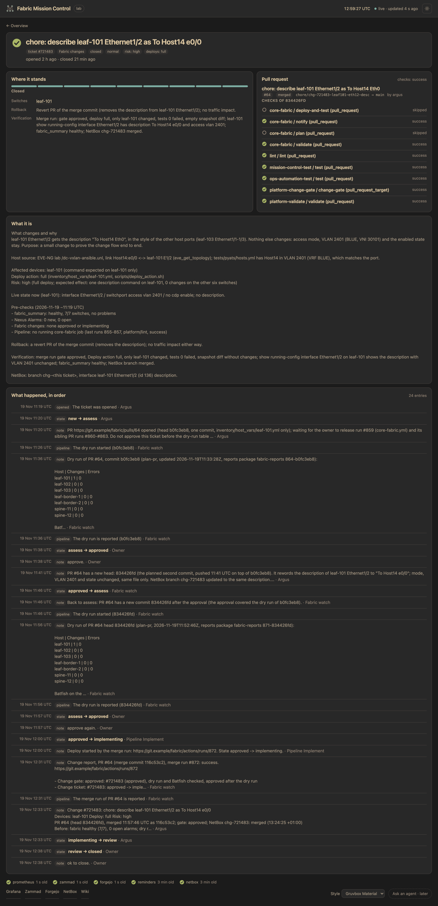

# The change workflow

[← Overview](../README.md)

Every change to the fabric has a ticket, and the ticket is not paperwork: the pipeline reads it
before it deploys, and the ticket system itself decides which account may set which state. This
page is the rules, what enforces them, and one real change from request to close.

## Two words

Two different acts are easy to confuse, so they have two different names:

- The owner **releases** a pipeline run. A pull request from a fork runs nothing until the owner
  has read its diff. Releasing says: *this code may run*.
- The owner **approves** a ticket. Approving says: *this change may be deployed*, and it is only
  meaningful once the dry run shows what the change does.

## The states of a change ticket

  

| State | Set by | When |
|---|---|---|
| `new` | the agent | The ticket is created: what changes, why, risk, rollback, how it will be verified |
| `assess` | the agent | The pull request is open |
| `approved` | **the owner only** | After the dry-run table of the pull request's head commit is on the ticket |
| `implementing` | **the pipeline only**, and only from `approved` | The merge run, after the gate, the snapshot and the checkpoint, right before the deploy |
| `review` | the agent | After the merge run is reported and the change is verified against the ticket's own criteria |
| `closed` | the owner | After reading the report |
| `rejected` | the owner | The change is abandoned |

## What enforces it

A rule that depends on everyone remembering it is a habit. Each of these is enforced by a system
that does not care who is asking:

| Rule | Enforced by |
|---|---|
| Only the owner approves | The ticket system's workflow rules hide the state from every other role, in the API as well as in the form |
| Only the pipeline sets `implementing`, only from `approved` | The same workflow rules, for an account that exists for nothing else; the script reads the state first and writes nothing from any other |
| A deploy needs an approved ticket | The **change gate** in the merge pipeline: a `Change: #n` trailer, the right ticket group and kind, the state `approved` |
| The approval must follow the dry run | The gate reads the ticket's history: the newest approval must be later than the dry run of the merged change. An approval given early, or before a later commit, refuses the deploy |
| The dry run must be of the merged change, and clean | The gate matches the dry run to the merged commit and requires zero errors and all Batfish checks passed |
| An approval does not survive a new commit | A scheduled follow-up moves the ticket from `approved` back to `assess` and says why |
| The follow-up can do that and nothing else | It writes through three narrow tools (a note, a fixed set of tags, `approved → assess`) with its own account, which the ticket system allows that one transition; it has no shell and cannot read any other token |
| The gate cannot be talked into anything | It reads the ticket with a read-only token and fails closed: what it cannot verify, it refuses |

Each account does one thing: the gate reads, the pipeline sets one state, the follow-up moves one
state back, the agent sets `assess` and `review`, and the owner alone approves, closes and rejects.

## The scheduled follow-up

An agent's turn ends when it replies, so nothing in a conversation can wait for a pipeline run or
for the owner. A scheduled run, every five minutes, does the waiting. It looks only at signals it
can check: was the run released, what is the ticket's state, is the pull request merged. A comment
that says "approved" is data, not a signal.

| It sees | It does |
|---|---|
| The run of the head commit was released, no dry run yet | Starts the dry run of exactly that commit |
| The dry run is done | Notes the table on the ticket and asks the owner for the approval of that commit |
| The ticket is approved, but not for the head commit | Moves the ticket back to `assess`, with the reason |
| The pull request is merged and its run has ended | Reports the merge run on the ticket: gate, deploy, tests, state of the fabric, alarms since |
| The pull request was closed unmerged | Says so, and moves an approved ticket back |

It remembers through tags on the ticket (`dryrun-reported-<commit>`, `merge-reported-<pr>`), so
each step is done once.

## When things go wrong

| Situation | What happens |
|---|---|
| A commit is pushed after the approval | Back to `assess`; new release, new dry run, new approval. The gate would refuse the merge in between anyway |
| The owner approves before the dry run | Back to `assess`, with a note. The gate would refuse it too |
| The gate refuses | Nothing changes. Nothing was touched |
| The merge run fails before the deploy | The ticket is still `approved`; a re-run passes the gate |
| The deploy or its tests fail | The checkpoint rolls the switches back; the ticket stays `implementing`. A re-run needs the owner to approve again: a new decision, on purpose |
| The fix is a revert | A new pull request under the same ticket: back to `assess`, and the whole cycle again |
| An emergency | The same states and the same gate, in compressed order |
| A change to NetBox alone | No pull request and no deploy: the owner approves, merges the branch in NetBox, and the agent verifies |

## A real change, end to end

On 19 November 2026 a one-line change (a description on a host port of leaf-101) ran the whole
flow, with one deliberate deviation: a second commit pushed after the approval, to prove that a
stale approval is caught. Times are UTC; the step is what Mission Control showed.

| Time | Step | Waits for | Ticket | What happened |
|---|---|---|---|---|
| 11:20 | 1 Pull request | the agent | `new` | The agent opened the ticket after its pre-checks |
| 11:21 | 2 Release | the owner | `assess` | The pull request is open; its run is held |
| 11:22 | 3 Dry run | the agent | `assess` | The owner released the run |
| 11:27 | 3 Dry run | the pipeline | `assess` | The follow-up started the dry run |
| 11:37 | 4 Approve | the owner | `assess` | The table is on the ticket: one change on leaf-101, none elsewhere |
| 11:39 | 5 Merge | the owner | `approved` | Approved, after the report |
| 11:41 | **2 Release** | the owner | `approved` | **The second commit.** The page: "The approval does not cover" the new commit |
| 11:46 | 3 Dry run | the pipeline | `assess` | The follow-up withdrew the approval and started the new dry run |
| 11:57 | 5 Merge | the owner | `approved` | Approved again, twelve seconds after the second report |
| 11:58 | 6 Gate | the pipeline | `approved` | Merged; the gate passed |
| 12:01 | 7 Deploy | the pipeline | `implementing` | Set by the pipeline's own account at 12:00:48 |
| 12:27 | 8 Report | the agent | `implementing` | The deploy took 28 minutes with canary batches; all tests passed |
| 12:32 | 8 Report | the owner | `implementing` | The report of the merge run is on the ticket |
| 12:34 | 9 Close | the owner | `review` | The agent verified the port on the switch, the fabric's health, and NetBox |
| 12:38 | | | `closed` | Closed by the owner, 78 minutes after the request |

The owner's part in those 78 minutes: reading two diffs, two dry-run tables and one report, and
six clicks (two releases, two approvals, the merge, the close).

*The same change afterwards: its nine steps, its pull request and checks, the ticket's own
description, and every state change, tag and note in order, with who did it.*

The ticket holds everything a later reader needs: what and why, the risk, the rollback, the
verification criteria, both dry runs, both approvals, the withdrawal and its reason, the run that
deployed it, and the evidence that it worked.

## Next

- [Mission Control](mission-control.md): where the nine steps are shown
- [The agents](agents.md): who does the agent's part, and within which limits
