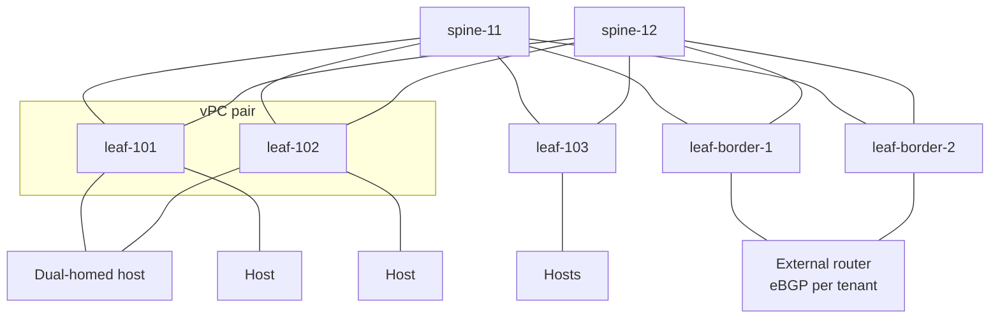
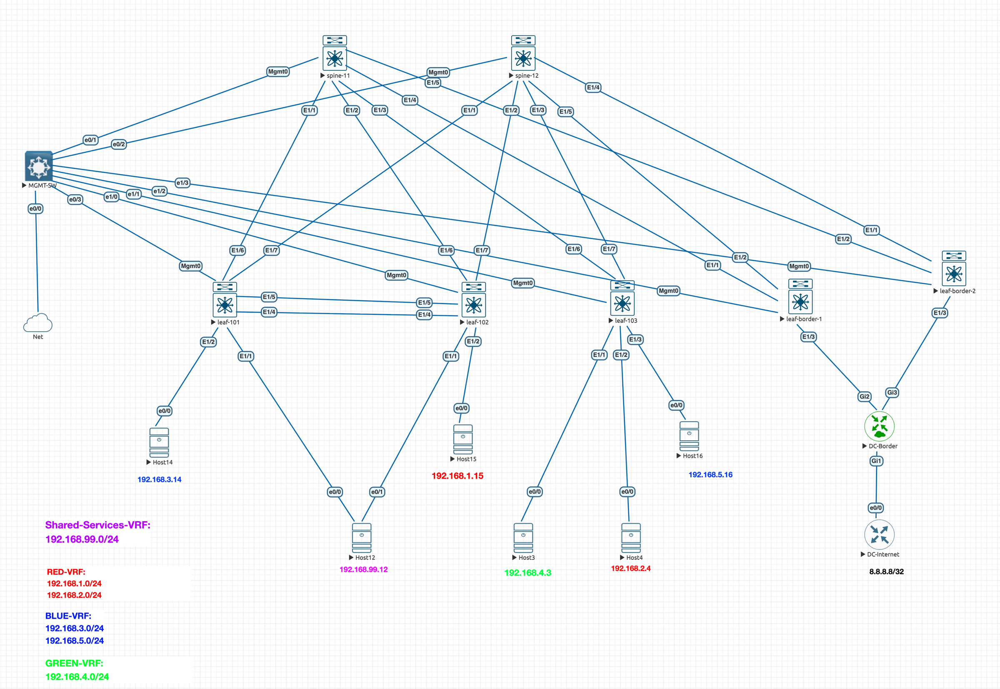

# The fabric

[← Overview](../README.md)

A small leaf-and-spine data centre fabric with VXLAN and BGP EVPN, multi-tenant, with a vPC pair
and an external connection per tenant. It is described once, in a data model, and everything else
is derived from that description.

## Topology



| Switch | Role | Notes |
|---|---|---|
| spine-11, spine-12 | Spine | OSPF, PIM rendezvous point, BGP EVPN route reflectors |
| leaf-101, leaf-102 | Leaf | A vPC pair: shared VTEP address, a dual-homed host on a vPC port channel |
| leaf-103 | Leaf | Standalone; the canary of every deploy |
| leaf-border-1, leaf-border-2 | Border leaf | Carry the tenants' L3VNIs and peer with the outside, one eBGP session per tenant |

All seven are Cisco Nexus 9000v (the 9300v image) on NX-OS 10.5(3). Every leaf has one routed
point-to-point link to each spine with jumbo MTU. Beyond the border leafs sits an external
router, configured by hand and not part of the model, which stands for the rest of the network.
Six small lab hosts hang off the leafs; the data plane tests log in to them and ping.



*The lab as drawn in EVE-NG, including the out-of-band management switch on the left.*

## Underlay

| | |
|---|---|
| Routing | OSPF, one area, point-to-point links, hello 1 s and dead 6 s |
| Loopbacks | One for routing and BGP, one for the VTEP; the vPC pair shares a secondary VTEP address |
| BUM traffic | Multicast: PIM bidir with a phantom rendezvous point on both spines, one group per L2VNI |
| MTU | 9216 on the fabric links |

The fast OSPF timers are a result of a game day: with the defaults, a silent link failure kept
traffic going into a dead link for the full 40 seconds of the dead timer. BFD is configured in the
model as well, but the virtual 9000v never brings a BFD session up, so the timers do the work here.

## Overlay

| | |
|---|---|
| Control plane | iBGP in one AS, address family L2VPN EVPN, peering between loopbacks, both spines as route reflectors |
| Data plane | VXLAN, with host reachability learned through BGP |
| Gateway | Distributed anycast gateway: the same gateway address and MAC on every leaf |
| Tenancy | One VRF per tenant with an L3VNI for routing between its networks, one L2VNI per network |
| Border | The border leafs hold the L3VNIs only: no tenant VLANs, no gateways |
| External | One eBGP session per tenant VRF on dot1q subinterfaces; tenant networks out, the default route in; keepalive 3 s, hold 9 s |

## Tenants

| Tenant | Networks | External | Reaches |
|---|---|---|---|
| RED | 3 | yes | itself, SHARED-SERVICES, outside |
| BLUE | 2 | yes | itself, SHARED-SERVICES, outside |
| GREEN | 1 | yes | itself, SHARED-SERVICES, outside |
| SHARED-SERVICES | 1 | no | every tenant, nothing outside |

Tenants are isolated from one another. Each one leaks routes to and from SHARED-SERVICES through
extra route targets and an import filter that admits the other side's gateway subnets and nothing
else. The tests check both directions: pairs that should reach each other do, and pairs that
should not, do not.

Numbering follows one scheme, so a number says what it is. With *x* the tenant's index:

| Object | Scheme | Example (BLUE, x = 1) |
|---|---|---|
| L3VNI | `5000x` on VLAN `200x` | VNI 50001 on VLAN 2001 |
| L2VNI | `30x0y` on VLAN `2(3+x)0y` | VNI 30101 on VLAN 2401 |
| Multicast group | the next free one of a fixed range | |

## The data model

The model is Ansible inventory. Three kinds of file, and each kind of change deploys differently:

| File | Describes | A merge deploys |
|---|---|---|
| `group_vars/leafs/tenants.yml` | Tenants: VRFs, networks, VNIs, gateways, route leaking | **tenant**: BGP and overlay roles on the leafs and border leafs; never the spines |
| `host_vars/<switch>.yml` | One switch: links, loopbacks, host ports, vPC, external connections | **full**: every role on every switch |
| `group_vars/*.yml` | Fabric-wide settings: features, NTP, OSPF, PIM, BGP, login security, telemetry | **full** |
| Documentation, tests, scripts, CI | | **nothing** |

A script decides the deploy action from the list of changed files; the same script answers the
question before a pull request is opened.

A network is a few lines:

```yaml
tenants:
  - name: BLUE
    l3vni:
      vlan_id: 2001
      vni_id: 50001
    networks:
      - name: VRF-BLUE-L2VNI-30101
        vlan_id: 2401
        vni_id: 30101
        ip_address: 192.168.3.1
        mask: 24
        mcast_grp: 239.1.1.3
    route_targets:
      import: ["65001:50003"]          # SHARED-SERVICES
    import_filter:
      networks_of: [SHARED-SERVICES]
    advertise_networks: true
```

From this the leafs get the VLAN, the VNI, the SVI with the anycast gateway, the EVPN instance and
the multicast group; the border leafs get the route advertisement; the tests get the expectation
that the network is up on every leaf and reachable from the outside; the documentation gets a row.

### Validation

Before anything else, the model is checked without touching a device:

- **Syntax and shape**: yamllint, then a JSON schema for the tenants.
- **Consistency**: VLAN ids, VNI ids and names unique across all tenants; no overlapping subnets
  between tenants that leak routes to each other; leak rules that name existing tenants;
  aggregates at the border that match the tenants' networks; timers and port numbers in range.
- **Safety**: a pinned SSH host key for every switch; login security present.

### Rules that bite

- **What is not in the model is removed.** Most resources are applied in *overridden* or
  *replaced* state. A deleted line in the model is a deleted line of configuration.
- **The feature list is authoritative.** NX-OS features that are not listed are disabled.
- **Unused ports are shut down.** A port exists in the model or it is off.

These rules are why the dry run matters: it shows every command a deploy would send, including
the removals nobody intended.

## From model to switch

| | |
|---|---|
| Engine | Ansible with the `cisco.nxos` resource modules over SSH; one automation account with key login; host keys pinned |
| Templates | 26 Jinja2 templates render the modules' payloads from the model |
| Roles | common, underlay, bgp, overlay, border, SNMP, telemetry, login security, removal of unknown users |
| Dry run | The same playbook in check mode; the commands each switch would receive are recorded per host |
| Toolchain | One container image with Ansible, pyATS, Batfish's client and the linters, every dependency locked by hash; the image is scanned and signed, and its tag is a hash of its inputs |

A person and the pipeline use the same image through the same wrapper, so "it worked on my
machine" and "it worked in CI" are the same statement.

## Next

- [The pipeline](pipeline.md): how a change to the model reaches the switches
- [Setup](setup.md): how the lab is built
