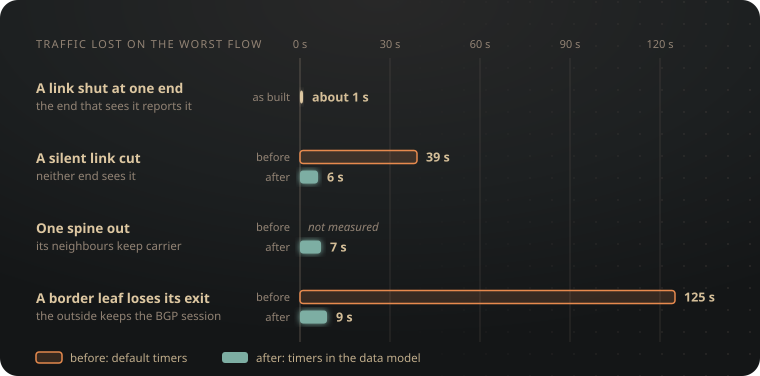

# Game days: failures, measured

[← Overview](../README.md)

"The fabric is redundant" is a claim. A game day turns it into a number: one thing is broken on
purpose, the time until traffic recovers is measured, the fault is undone, and the fabric is
checked to be as it was. Then the design is changed, and the same fault is measured again.

  

## The results

| Scenario | The fault | Before | After | What changed |
|---|---|---|---|---|
| **A link shut at one end** | An uplink of leaf-103 is shut down | about 1 s | | Nothing needed to |
| **A silent link cut** | The same link is cut in the middle: neither switch sees its interface go down | **39 s** | **6 s** | OSPF hello and dead timers from 10 and 40 seconds to 1 and 6 |
| **One spine out** | Every fabric link of spine-12 goes down | not measured | **7 s** | The same timers; with the defaults the leafs would have waited 40 s |
| **A border leaf loses its exit** | leaf-border-1's link to the outside goes down | **125 s** | **9 s** | The eBGP hold time from 180 seconds to 9, with a keepalive of 3 |
| **A vPC member link** | One member of a host's port channel goes down | the lab broke | | Removed from the automated set |

All figures are traffic lost on the worst affected flow, from pings at one-second resolution.
Both timer changes went in as ordinary changes to the data model, through the pipeline.

## How a game day runs

| Step | What happens |
|---|---|
| Guard | Refuses while another pipeline run is active or a scheduled test is near. It fails closed |
| Checkpoint | On the switch that will be faulted |
| Probes | Six flows, one per lab host, chosen to cross the fault, plus control flows that do not |
| The fault | Applied through the automation, timed from the moment the configuration is sent |
| Observation | Each observed switch's OSPF adjacency history and its log: interface, OSPF, BGP, PIM, VXLAN, vPC and port-channel events, each as an offset from the fault |
| The undo | Runs even if the game day fails midway |
| Compare | The switch against its checkpoint: an empty difference is "unchanged", anything else is rolled back |
| Tests | The normal test run of the switch and the lab hosts |
| Report | Loss per flow and the event timeline, stored with the run |

A probe that keeps losing is stopped two minutes after the scenario ends, so a broken lab cannot
hold a runner for hours. That limit exists because one scenario did exactly that.

### The noise floor

A virtual lab is not quiet. A run with no fault at all showed every flow losing pings at the same
moments, up to four seconds, every one to three minutes: the virtual switches forward in
software, so a stall of the lab's host is a stall of every switch at once. A scenario's result
counts only what lies above that, which is why the table says "about 1 s" and not a fraction.

## What each scenario taught

### A link shut at one end: about one second

The first reading was wrong, and the record says so. When the uplink was shut on the leaf, the
spine kept its OSPF adjacency for 35 to 40 seconds, and that was taken for a 40-second black
hole. It is not one. The leaf sees its own interface go down and tells the fabric at once; OSPF
uses a link only when both ends list it, so every switch stops routing over it within about a
second. The stale adjacency on the far end costs nothing.

It took three runs to see that, because the virtual switch programs one path where the routing
table has two. Whether a flow crossed the faulted link was a matter of chance until the game day
began to record the forwarding path before the fault.

### A silent link cut: 39 seconds, then 6

The 40 seconds matter when *neither* end sees the failure: a cut in the middle of a link, a hung
switch, a link that stops passing traffic. An access list could not simulate it on the virtual
switch, so the link is cut on the lab's host, between the two virtual interfaces.

| | Default timers (10 / 40 s) | Timers in the data model (1 / 6 s) |
|---|---|---|
| Traffic over the cut link lost | 39 s | **6 s** |
| The two switches declare the neighbour down | 38.6 and 39.6 s after the cut | 4.6 and 5.9 s |
| Adjacency back after the link returns | about 8 s | under 1 s |

The textbook answer is BFD, and BFD is in the data model. But on this virtual switch a BFD
session never comes up: it sends and never receives. So the lab runs on fast OSPF timers, and the
BFD configuration stays as the design for real hardware.

### One spine out: 7 seconds

A spine whose links all go down sees it, and can tell no one. Its neighbours keep carrier on a
virtual link and wait out the dead timer: a node that drops off is silent to its neighbours. With
the new timers that is 7 seconds on the flows through that spine.

### A border leaf loses its exit: 125 seconds, then 9

The worst result, and nothing in the fabric was at fault. The border leaf stopped sending at
once. The router *outside* did not see the link go down, kept its eBGP sessions, and went on
sending return traffic into a dead link until BGP's default hold time gave up.

| | Hold time 180 s | Hold time 9 s |
|---|---|---|
| Worst return flow lost | 125 s | **9 s** |
| BGP in the fabric's log | nothing | sessions down 0.3 s after the fault, up 1.3 s after the undo |

The second row is its own finding: the fabric had logged no BGP event at all. Neighbour-change
logging went into the data model with the timers. BGP uses the smaller hold time of its two
sides, so the outside router needed no change.

### A vPC member link: the lab broke

The virtual switch could not put the interface back into its port channel. Neither a bounce nor
rebuilding both interfaces cleared it; a reload of the leaf did. The scenario is kept for real
hardware and taken out of the automated set, and two things changed because of it: probes are
bounded, and the game day no longer trusts a configuration compare alone, since it would have
reported "unchanged" with the port disabled. The tests that follow are what catch that.

## What no dry run could show

The timer work needed four changes. Two of them failed on the way in, each in a way that neither
check mode nor Batfish could have predicted, and each ended the same way:

| Change | What went wrong | What happened |
|---|---|---|
| BFD with a 1000 ms interval | The switch refused the value: its range ends at 999 | The canary leaf failed and was rolled back; the other six switches were never touched; tests passed |
| BFD with 500 ms | Nothing, in the deploy | Deployed, green; and no session ever came up, which is how the missing BFD support was found |
| The OSPF timers | The next task's Ansible module crashed on every fabric link, mistaking the OSPF line for a PIM one | The run failed and rolled back; tests passed |
| The same, with that task rewritten | | Deployed in one batch, green; no adjacency flapped |

Check mode does not send a command, so it cannot learn that a switch will refuse it. Batfish has
no model of BFD. The dry run is necessary and it is not sufficient; the canary, the checkpoint
and the tests are what make a wrong change cheap. The validation now checks the BFD interval's
range, so that mistake cannot be merged again.

## The limits of a lab

- **One path, not two.** The virtual switch's software data plane uses a single next hop where
  hardware would spread flows over both spines. A fault hits all flows or none; on hardware it
  would hit about half.
- **Noise.** Sub-second detection cannot be shown with pings here. It shows in the switches' logs.
- **No BFD.** The timers that replace it are far slower than real hardware's.
- **Faults the virtual switch cannot survive** are kept out of the automated set.

The numbers are therefore not what a hardware fabric would do. They are evidence of something
else: that a design question was answered by measuring, and that the fix was a few lines in a
data model, deployed and verified like any other change.

## On the calendar

A game day runs every month, next to the rollback drill, opened by the reminder workflow. The
scenarios are a file in the repository; a new one is a few lines naming the switch, the fault, its
undo and the flows to watch.

## Next

- [Operations](operations.md): the other drills
- [The fabric](fabric.md): where the timers live
- [The pipeline](pipeline.md): the canary and the rollback that the failed changes ran into
