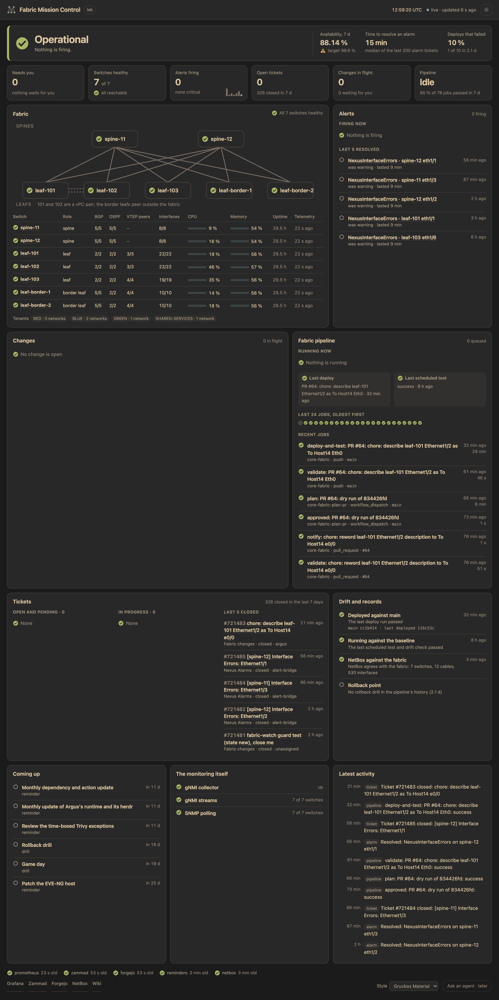
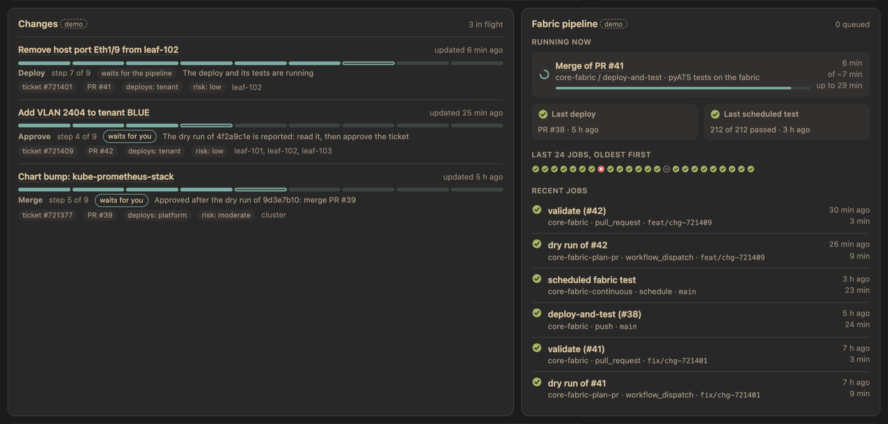
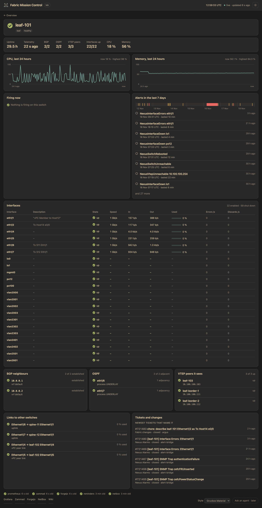

# Mission Control

[← Overview](../README.md)

One page that answers "how is the fabric, and does anything wait for me?". It reads the systems
that already hold the answers and changes nothing: no button on it does anything to the fabric.

## What is on it

| Panel | Shows | Read from |
|---|---|---|
| **Verdict** | One line: operational, operational with warnings, or incident; and the three service levels | Alarm state |
| **Key figures** | What waits for the owner, switches healthy, alarms firing, open tickets, changes in flight, the pipeline | The panels below |
| **Fabric** | The topology with each switch's state; per switch: BGP, OSPF and VTEP peers against the expected number, interfaces, CPU, memory, uptime, age of its telemetry; the tenants | Prometheus |
| **Alerts** | What fires now, and the last five that resolved | Prometheus |
| **Changes** | Each open change: its step of nine, who it waits for, and in words what is awaited | The ticket system and the forge |
| **Fabric pipeline** | What runs now with its usual and its longest duration, the last deploy, the last scheduled test, the last 24 jobs | The forge |
| **Tickets** | Open and pending, in progress, the last closed | The ticket system |
| **Drift and records** | Is `main` deployed, does the fabric match its baseline, does NetBox agree with the fabric, when was the last rollback drill | The forge, NetBox |
| **Coming up** | The next operations tasks: rotations, updates, drills | The reminder calendar in Git |
| **The monitoring itself** | Is the collector up, how many telemetry streams and SNMP polls work | Prometheus |
| **Latest activity** | Alarms, pipeline jobs, changes and closed tickets in one timeline | All of the above |

Every source is polled on its own. A source that does not answer keeps its last good answer on the
page, marked with its age, and the footer says which source is behind. The page updates through a
stream, without reloading.

## A change in flight

*Recorded demo data (the panels are marked "demo"): three changes at different steps, and a
deploy in progress.*

Where a change stands is not read from the ticket's state alone. The page also asks the forge
about the change's pull request: is it open, merged or closed; which commit is its head; is the
run of that commit held or released; is there a dry run of it; is there a merge run, and how did
it end. So it can say things the ticket cannot:

- "Release the run of `834426fd`; do not approve the ticket yet"
- "The approval does not cover `834426fd`: the ticket goes back to assess"
- "Approved after the dry run of `834426fd`: merge the pull request"
- "The deploy failed, the checkpoint rolled back"

Only the dry run of the *head* commit counts, and the order of dry run and approval is read from
the ticket's history. The page applies the same rule as the deploy gate, so it shows a stale
approval before the gate would refuse it. The rules are on the page about
[the change workflow](change-workflow.md).

## Detail pages

### A change

Open or closed: the nine steps, the pull request and its checks, the ticket's description with
rollback and verification, and everything that happened in order: state changes, the follow-up's
steps, every note, and who did each.

### A switch

State and uptime, CPU and memory over 24 hours, every alarm of the last seven days on a time
line, every enabled interface with speed, traffic, utilisation and errors, the BGP neighbours,
OSPF adjacencies and VTEP peers one by one, the links to other switches, and the newest tickets
that name the switch.

### NetBox against the fabric

NetBox is the record of the fabric, and a record is only worth something if it is right. The page
compares it three ways:

| NetBox against | What is compared |
|---|---|
| The inventory's links | Every switch is a device; every link has its cable, and every cable is a link |
| What the switches report | Interfaces with admin state and MTU, the software version, the serial number |
| The data model | VRFs, VLANs, VNIs, the addresses on interfaces and gateways |

It also lists NetBox branches of changes that were deployed but never merged.

## How it is built

| | |
|---|---|
| Backend | Python, standard library only: no framework, no dependency to patch |
| Front end | Plain HTML, CSS and JavaScript modules: no build step |
| Data | One snapshot of everything, a stream of it, and detail endpoints for a switch, an alarm, a change |
| Sources | A source per system, each with its own interval and a read-only account of its own |
| Sign-in | OpenID Connect against the lab's identity provider, with an allow-list |
| Deployment | A scanned and signed image on the cluster, behind the gateway |
| Tests | 114 backend tests without the network, against recorded answers of the real systems |
| Demo mode | Every source can be replaced by a recording, so the page can be shown without the lab |

Two rules shaped it. **Read-only**: every account it uses can read and nothing else, and every
name that goes into a question to a system is checked first. **Say what you do not know**: a
figure that could not be measured is shown as not measured, never as zero or as fine.

## Next

- [The change workflow](change-workflow.md): the rules behind the nine steps
- [Observability](observability.md): where the fabric's data comes from
