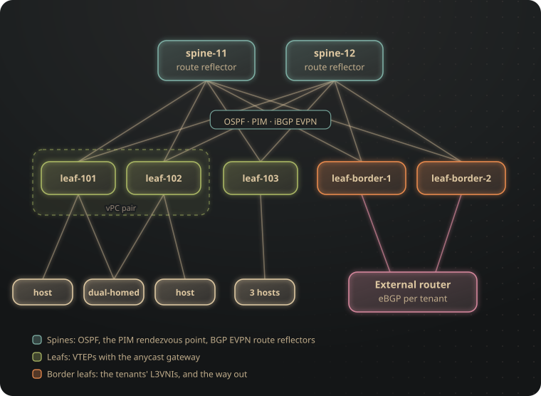

# Multi-Site

[← Overview](../README.md)

The fabric began as one site of seven switches. Between 20 and 25 November 2026 it gained a fourth
leaf, a second site and a network between the sites: fourteen switches, joined by VXLAN EVPN
Multi-Site. Nothing
about the method changed for it. The second site was designed in a document, declared in the data
model, provisioned without anyone typing on a switch, and deployed by the same pipeline behind the
same change tickets, while the first site kept running.

This page says how the two sites are joined, in which order it was built, what the work found,
and where it stands.

  

## The design

| | |
|---|---|
| Sites | **DC-1**, AS 65001, site id 1: eight switches. **DC-2**, AS 65002, site id 2: four switches |
| Inter-site network | AS 65000: two routers, isn-1 towards DC-1 and isn-2 towards DC-2, one link between them. IPv4 only: no OSPF, no PIM, no VXLAN |
| Border gateways | Anycast border gateways on the spines of both sites, two per site |
| Inside a site | Unchanged: OSPF, PIM with an anycast rendezvous point on the two spines, iBGP EVPN with the spines as route reflectors |
| Between the sites, underlay | eBGP IPv4 from each gateway to its inter-site router; iBGP between the two routers. Only loopbacks are carried |
| Between the sites, overlay | eBGP L2VPN EVPN, multihop, from every gateway of one site to every gateway of the other: four sessions |
| Route targets | Automatic, rewritten to the receiving site's AS at the gateways. That works because the VNIs are the same in both sites |
| Flooded traffic | Multicast inside a site, ingress replication between the sites |
| To be stretched | All four tenants: their four L3VNIs and all seven L2VNIs ([where that stands](#where-it-stands)) |
| The way out | DC-2 has no border leaf. Its way out is through DC-1's border leafs |
| DC-2's leafs | Single-homed, no vPC |

The tenants are one file for both sites. A leaf of DC-2 gets the same VRFs, VNIs, gateway
addresses and gateway MAC as a leaf of DC-1, and a route target that imports another tenant's
routes is written with the site's own AS.

## A border gateway on a spine

A spine of this fabric now does four jobs: underlay router, rendezvous point, route reflector,
and border gateway. As a gateway it has:

| | |
|---|---|
| A site id | The same on both gateways of a site |
| A shared address | One loopback address that both gateways of the site hold. The other site sends to it, whichever gateway answers |
| An address of its own | A VTEP loopback of its own, which a spine did not need before |
| Tracked links | Its links into the fabric and its link to the inter-site network are tracked. A gateway that loses one side stops attracting traffic it could not deliver |
| A delay after a restart | It waits before it serves the shared address, until its fabric side has converged |
| The tenants | Once it stretches them: the VRFs and VNIs of every tenant, without gateway addresses, because a spine has no hosts |

Putting the gateway on the spine saves two switches per site. It has a price, which showed
during the work: see *The gateways of a site did not know each other* below.

## How it was built

Each step was a change of its own, with its own ticket, dry run and tests. The order kept two
rules: nothing new on DC-1 before it worked on DC-2, and never both spines of DC-1 in one step.

| Step | What | How it was deployed |
|---|---|---|
| Design | The lab as cabled, the host's capacity, what the platform supports, the address plan; six open questions, decided by the owner on 22 November 2026 | Nothing: a document |
| Sites in the model | Every switch into exactly one site group, which holds the AS, the route reflectors and the rendezvous point | A refactoring: nothing changed on the switches |
| The inter-site routers | isn-1 and isn-2, provisioned zero-touch on 22 November, with a role of their own | A join through the pipeline |
| DC-2 as a fabric of its own | Four switches, provisioned zero-touch on 23 November; its own AS, route reflectors and rendezvous point; the tenants of DC-1 | A join of all four in one change |
| DC-1's rendezvous point | From PIM bidir to sparse mode with an anycast rendezvous point, which Multi-Site requires | All eight switches of DC-1 in one batch, in a window: the mode has to change everywhere at once |
| DC-2's gateways | spine-21 and spine-22 become border gateways; isn-2 gets its links to them | No command to a switch of DC-1. The sessions to DC-1's gateways are configured and stay down, as the tests expect |
| DC-1's gateways | spine-12 first, with isn-1's link to it; then spine-11 | Two pull requests of one change, each in a window |
| The tenants on the gateways | DC-2's two gateways first (done); then spine-12; then spine-11 (both to come) | A change each. No command to a leaf |

The zero-touch steps are described under [setup](setup.md#2-day-zero-on-each-switch).

## What the work found

### The platform decides, not the configuration

The first site ran PIM bidir. The vendor's guide lists bidir as not supported for the underlay
of a Multi-Site fabric. A reference configuration of a spine gateway with bidir existed and was
accepted by NX-OS, which shows that the switch takes the commands, not that the combination is
supported. So DC-2 was built with sparse mode from the start, and DC-1 was moved in a change of its
own before any gateway was configured there.

### The canary cannot split a link

A full deploy goes in batches: one leaf, one spine, then the rest, each batch tested before the
next. When spine-12 became a gateway, its link to isn-1 needed both ends. spine-12 is in the
second batch and isn-1 in the third, so the canary would have tested a session whose other end
was not yet configured, failed, and rolled back. That one change was marked to deploy in one
batch. The checkpoint, the tests of all fourteen switches and the rollback stayed as always, and
the dry run showed that every switch but those two would get no command.

The next change needed no such mark: spine-11 and isn-1 are both in the last batch.

### A dry run must not write

Preparing these changes turned up two modules of the Ansible collection that loaded
configuration even in check mode. Both tasks were rewritten with a module that honours check
mode, so that a dry run cannot write and a switch that already matches gets nothing.

### The tests know what is not there yet

DC-2's gateways were configured days before DC-1's. Their sessions to DC-1 could not come up, and
that was correct. The expectations are rendered from the data model, so the tests required the
sessions *configured* while the other side was not declared, and *established* from the moment it
was. Nobody edited a test to make a half-built fabric pass.

### The gateways of a site did not know each other

Anycast gateways of a site elect, per VNI, one of them to forward flooded traffic that arrives
from the other site. They elect from routes they exchange with each other. Here the gateways are
the spines, the spines are route reflectors, and two route reflectors of one site have no session
to each other. Each gateway saw only itself and elected itself for everything.

That was found on 25 November 2026, by reading the election on all four spines after the first
tenants were stretched. It was harmless at that moment, because no flooded traffic crossed the
sites yet. One step later, DC-1's flooded traffic would have arrived in DC-2 twice, and with
both sites stretched it could have looped.

The vendor's design guide says so for exactly this placement: gateways on spines need an extra
iBGP session between them. The fix is that session, between the gateways of a site, declared in
the data model, checked by validation, and tested: the gateways must list each other as members
and agree on the forwarders. It went to DC-2 first.

### Smaller things

- **POAP finds a lab switch by the MAC of its management port.** The hypervisor's default MAC is
  not the one the model expects, so it is set on each node before its first boot.
- **One switch at a time.** A booting virtual switch keeps its processors busy for minutes. The
  six new nodes were started one by one, each watched until it answered, with a stop rule for the
  host's memory.
- **The lab's ports are finite too.** With the link to the inter-site router, DC-1's spines use
  every port they have. A fifth leaf there needs a maintenance window first.

## Where it stands

As of 25 November 2026:

| | |
|---|---|
| **Done** | Fourteen switches in the model, deployed, tested and monitored. The spines of both sites are border gateways, and the tests require all four EVPN sessions between the sites. The tenants are stretched on DC-2's gateways, and DC-2's gateways elect their forwarders together. Mission Control draws both sites from the data model. NetBox records DC-2 |
| **Next** | The tenants on spine-12; the session between DC-1's gateways, one end at a time so the canary keeps working; the tenants on spine-11 |
| **Waiting** | A lab host in DC-2. Until it exists, nothing can ping from one site to the other, so these are not tested: a host reaching a host of its own network in the other site, another network of its tenant, shared services, and the outside through DC-1's border leafs. NetBox does not record the inter-site network yet, and Mission Control shows that as one difference |

Until DC-1's gateways carry the tenants, the two sites exchange routes but no traffic. A route
from DC-2 that reaches a leaf of DC-1 points at an address DC-1's underlay does not carry; it is
never installed, and each verification counts such routes to make sure of it.

## Limits

- **One path between the sites.** Two inter-site routers in a row, one link between them. Any of
  the three failing cuts the sites apart. A second link is planned and blocks nothing.
- **Batfish does not model it all.** It checks the sessions between the sites and where every VNI
  should be. Replication between the sites and a gateway's re-origination of the other site's
  routes are outside its model; the tests on the switches cover those.
- **Virtual switches.** The feature is listed as supported on this platform, without vPC on the
  gateway. What the data plane does under failure is evidence of a method, as everywhere in this
  lab.

## Next

- [The fabric](fabric.md): the design inside a site
- [The pipeline](pipeline.md): the batches, the checkpoint and the rollback these steps relied on
- [Decisions and limits](decisions.md)
