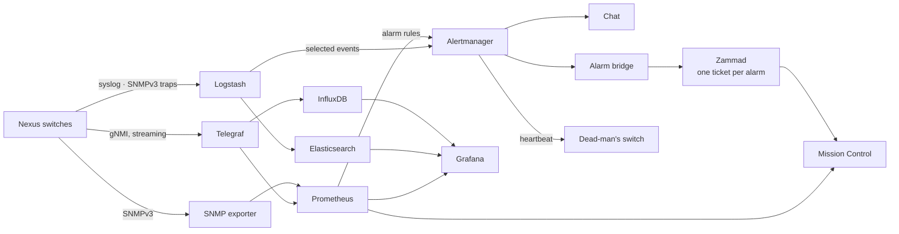

# Observability

[← Overview](../README.md)

The switches are watched four ways at once, and an alarm is not a message in a channel: it is a
ticket that opens with its evidence and its runbook, and closes by itself when the condition
clears.

## From the switch to a ticket

## Sources

| Source | Collector | What | How often |
|---|---|---|---|
| **gNMI** | Telegraf, one subscription per switch over verified TLS | OpenConfig interface counters and state, BGP neighbour state; native NX-OS CPU, memory, OSPF adjacencies, VTEP peers | every 60 s |
| **SNMPv3** | SNMP exporter | Interface counters and errors, system uptime | every 60 s |
| | | The chassis serial number, for the comparison with NetBox | every 4 min |
| **Syslog** | Logstash | Every message, parsed into fields (switch, facility, severity, mnemonic, interface) | as it happens |
| **SNMPv3 traps** | Logstash | Events that the streamed state does not cover | as it happens |

Two independent paths (gNMI and SNMP) are deliberate: an alarm for an unreachable switch fires
only when *both* are silent, and the loss of one path is its own, lesser alarm.

| Store | Holds | Kept |
|---|---|---|
| Prometheus | Metrics and alarm state | 15 days |
| InfluxDB | The gNMI series at full resolution | 30 days |
| Elasticsearch | Syslog and traps | 14 days |
| Loki | The platform's own logs | 14 days |

## Alarm rules

Sixteen rules on metrics and two on events. Each belongs to one of ten runbooks.

| Alarm | Fires when |
|---|---|
| NexusSwitchUnreachable | Neither gNMI nor SNMP hears from a switch |
| NexusSwitchRebooted | A switch's uptime restarted |
| NexusInterfaceDown | An interface is administratively up, operationally down, and was up in the last 24 hours |
| NexusInterfaceFlapping | An interface changes state repeatedly |
| NexusInterfaceErrors, NexusInterfaceDiscards | Error or discard counters rise |
| NexusInterfaceHighUtilisation | A link is above 85 % |
| NexusOspfAdjacencyDown | An underlay adjacency is missing |
| NexusBgpNeighborDown | An EVPN or external BGP session is not established |
| NexusBgpCiliumPeerDown | The BGP session between the fabric and the cluster's network is down |
| NexusVtepUnreachable | A leaf lost a VTEP peer |
| NexusHighCpu, NexusHighMemory | Above 90 % for 15 minutes |
| NexusGnmiStreamDown | One switch's telemetry stream stopped |
| NexusSnmpPollingDown | SNMP polling of a switch fails |
| NexusTelemetryDown | The collector itself is not being scraped |
| NexusSyslogEvent | A syslog message of severity 0 to 2, or one of a list of mnemonics (loops, duplicate addresses) |
| NexusSnmpTrap | A trap that no metric rule covers |

The monitoring is monitored: a heartbeat alarm that always fires is sent to an external
dead-man's switch, which raises its own alarm when the heartbeat stops.

## Alarm tickets

The bridge between Alertmanager and the ticket system turns alarms into tickets with a life cycle:

| Event | The bridge |
|---|---|
| An alarm fires | Opens one ticket, keyed by the alarm and its object, with the alarm's facts, evidence read from the switch, and a link to the runbook |
| It fires again | Adds a note to the same ticket |
| It resolves | Closes the ticket |
| It fires again within the hour | Reopens it instead of opening a new one |

An agent triages each new alarm ticket within minutes: it reads the state, the logs and recent
changes, writes what it found as an internal note, and never closes the ticket or touches the
switch. The owner reads a diagnosis, not a raw alert.

The result is a history that can be counted: how often each alarm fired, how long each lasted,
the median time from open to close.

## Dashboards

| Dashboard | Shows |
|---|---|
| Fabric telemetry | Throughput, port state, errors, CPU and memory per switch, from gNMI |
| SNMP interfaces | Counters, errors and utilisation per interface |
| Syslog and traps | Events over time by switch, severity and mnemonic |
| Audit | Logins, privileged commands, every MCP tool call, every write an agent made, runner logs |
| Platform | GitOps reconciliation, the cluster's network, databases, nodes, application logs |

## Service levels

Three figures, on Mission Control:

| Figure | Meaning |
|---|---|
| **Availability** | The share of time without a critical fabric alarm |
| **Time to resolve** | The median time from an alarm ticket's opening to its closing |
| **Deploys that failed** | The share of merge runs whose deploy job failed |

They are measured, not curated: a week in which the lab host was rebuilt shows as a week below
target.

## Next

- [Mission Control](mission-control.md): the same data on one page
- [Operations](operations.md): game days, which test whether the alarms fire
