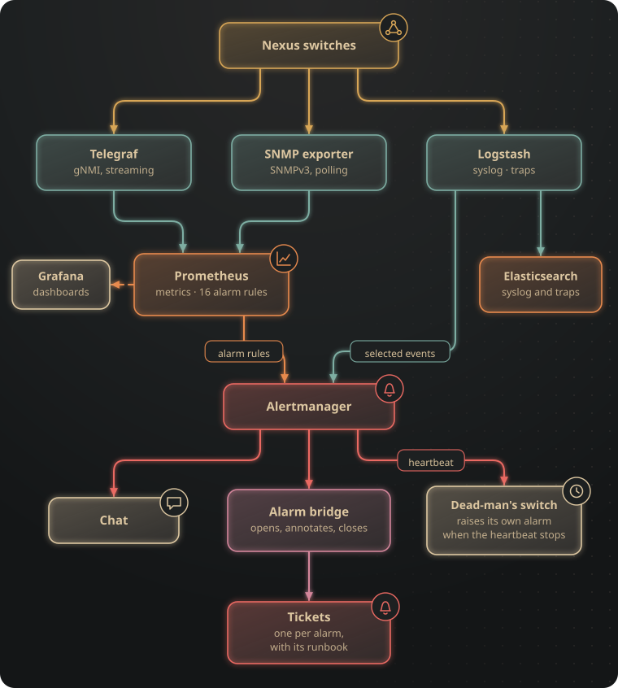
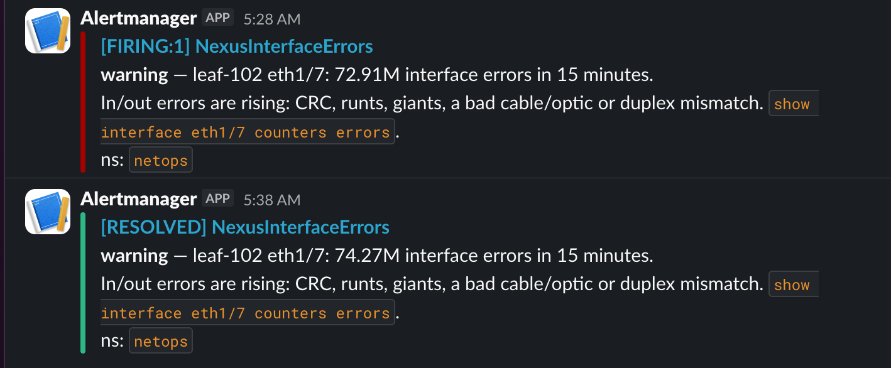
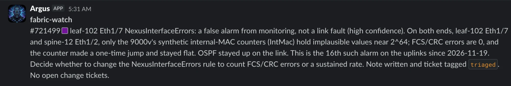
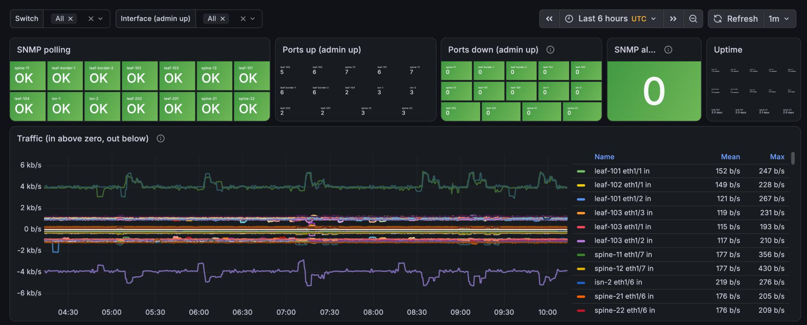
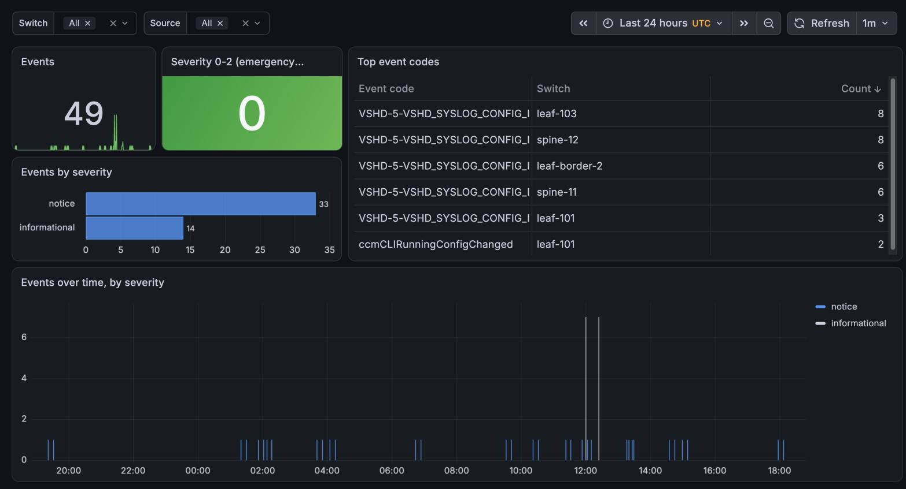

# Observability

[← Overview](../README.md)

The switches are watched four ways at once, and an alarm is not a message in a channel: it is a
ticket that opens with its evidence and its runbook, and closes by itself when the condition
clears. All fourteen are watched the same way: the spines and leafs of both sites and the two
inter-site routers.

## From the switch to a ticket

  

## Sources

| Source | Collector | What | How often |
|---|---|---|---|
| **gNMI** | Telegraf, one subscription per switch over TLS, verified against the fabric's own certificate authority | OpenConfig interface counters and state, BGP neighbour state; native NX-OS CPU, memory, OSPF adjacencies, VTEP peers | every 60 s |
| **SNMPv3** | SNMP exporter | Interface counters and errors, system uptime | every 60 s |
| | | The chassis serial number, for the comparison with NetBox | every 4 min |
| **Syslog** | Logstash | Every message, parsed into fields (switch, facility, severity, mnemonic, interface) | as it happens |
| **SNMPv3 traps** | Logstash | Events that the streamed state does not cover | as it happens |

Two independent paths (gNMI and SNMP) are deliberate: an alarm for an unreachable switch fires
only when *both* are silent, and the loss of one path is its own, lesser alarm.

A switch that joins the fabric gets its place in all four: a telemetry subscription, an SNMP
target, a syslog and a trap port of its own, and an entry in the alarm bridge's inventory, which
is what lets a ticket say which switch and which neighbour an alarm is about. The certificate its
gNMI server presents is enrolled before it joins ([Security](security.md#certificates-for-telemetry)).

| Store | Holds | Kept |
|---|---|---|
| Prometheus | Metrics and alarm state | 15 days |
| InfluxDB | The gNMI series at full resolution | 30 days |
| Elasticsearch | Syslog and traps | 14 days |
| Loki | The platform's own logs | 14 days |

## Alarm rules

Sixteen rules on metrics and two on events. Each belongs to one of ten runbooks.

| Alarm | Fires when |
|---|---|
| NexusSwitchUnreachable | Neither gNMI nor SNMP hears from a switch |
| NexusSwitchRebooted | A switch's uptime restarted |
| NexusInterfaceDown | An interface is administratively up, operationally down, and was up in the last 24 hours |
| NexusInterfaceFlapping | An interface changes state repeatedly |
| NexusInterfaceErrors, NexusInterfaceDiscards | Error or discard counters rise |
| NexusInterfaceHighUtilisation | A link is above 85 % |
| NexusOspfAdjacencyDown | An underlay adjacency is missing |
| NexusBgpNeighborDown | A BGP session is not established: EVPN inside a site or between the sites' border gateways, or external |
| NexusBgpCiliumPeerDown | The BGP session between the fabric and the cluster's network is down |
| NexusVtepUnreachable | A leaf lost a VTEP peer |
| NexusHighCpu, NexusHighMemory | Above 90 % for 15 minutes |
| NexusGnmiStreamDown | One switch's telemetry stream stopped |
| NexusSnmpPollingDown | SNMP polling of a switch fails |
| NexusTelemetryDown | The collector itself is not being scraped |
| NexusSyslogEvent | A syslog message of severity 0 to 2, or one of a list of mnemonics (loops, duplicate addresses) |
| NexusSnmpTrap | A trap that no metric rule covers |

The monitoring is monitored: a heartbeat alarm that always fires is sent to an external
dead-man's switch, which raises its own alarm when the heartbeat stops.

## Alarm tickets

The bridge between Alertmanager and the ticket system turns alarms into tickets with a life cycle:

| Event | The bridge |
|---|---|
| An alarm fires | Opens one ticket, keyed by the alarm and its object, with the alarm's facts, evidence read from the switch, and a link to the runbook |
| It fires again | Adds a note to the same ticket |
| It resolves | Closes the ticket |
| It fires again within the hour | Reopens it instead of opening a new one |

An agent triages each new alarm ticket within minutes: it reads the state, the logs and recent
changes, writes what it found as an internal note, and never closes the ticket or touches the
switch. The owner reads a diagnosis, not a raw alert.

The result is a history that can be counted: how often each alarm fired, how long each lasted,
the median time from open to close.

### An alarm ticket, start to finish

A real one, from 19 November 2026, when the fabric was one site of seven switches. The bridge
opened it within a minute of the rule firing:

  

*The ticket as the bridge opened it: what, where, how bad, what to check first, the runbook, and
the switch's own log lines from before the alarm. The note outlined below it is the triage.*

Four minutes later the agent's triage was on the ticket as an internal note:

> **Evidence:**
> - The error counter in Prometheus, one hour: 0 until about 11:48 UTC, then one jump to
>   2147750645 (about 2^31) and flat since. That is one step in the counter, not a steady error
>   rate.
> - On the switch: FCS, alignment, runts, giants, symbol and CRC errors all 0, discards 0; the
>   transmit-error counter just above 2^63. Values that size are impossible on a 1G virtual link;
>   they are garbage counters.
> - Far end, leaf-101 Eth1/7: every error counter 0.
> - Fabric health, all 7 switches: healthy (EVPN sessions, VTEP peers, VNIs, vPC as expected).
> - Syslog for both ends: no lines.
> - Pipeline: no deploy. A check-mode dry run overlaps the jump; it only logs in and pushes
>   nothing, so it is at most a coincidence. Low confidence on that link.
>
> **Cause:** monitoring, not fabric. A bogus MAC error counter on the virtual switch.
> **Confidence:** high.
> **Recommendation:** no fabric change. The alarm should clear by itself once the jump leaves the
> rule's 15-minute window, if the counter stays flat.

And ten minutes after it opened, the bridge closed it:

> **Alarm Cleared** · First Detected 11:52:53 UTC · Cleared 12:01:53 UTC · Duration: 9m
> The alarm resolved in Prometheus and the ticket was closed automatically. Reopen it if a root
> cause still needs follow-up.

In the picture the switch's management address and the site's name are replaced; the notes are
shortened and otherwise as written. Nobody had to act, nothing was touched, and the record says
what it was.

### The same in chat

The next morning the same kind of alarm fired on another link. In the chat channel it reads like
this, in local time: the alarm, ten minutes later its resolution,

and in between, three minutes after it fired, the agent's triage from its scheduled run:

The triage does more than dismiss it. It counts (the sixteenth such alarm on the uplinks in two
days), names the cause (a synthetic counter of the virtual switch, with the real error counters at
zero), and puts the decision where it belongs: whether to change the alarm rule so that it counts
real errors or a sustained rate. The fix for a noisy alarm is a change to the rule, through a
pull request, not a habit of ignoring it.

## Dashboards

| Dashboard | Shows |
|---|---|
| Fabric telemetry | Throughput, port state, errors, CPU and memory per switch, from gNMI |
| SNMP interfaces | Counters, errors and utilisation per interface |
| Syslog and traps | Events over time by switch, severity and mnemonic |
| Audit | Logins, privileged commands, every MCP tool call, every write an agent made, runner logs |
| Platform | GitOps reconciliation, the cluster's network, databases, nodes, application logs |

*SNMP interfaces, six hours on 25 November 2026: polling works for all fourteen switches, every
enabled port is up, no alarm fires, and the traffic of a quiet lab.*

*Syslog and traps, one day: 49 events, none of severity 0 to 2, by event code and switch. The two
tall bars around noon fall inside the deploy of the change on the
[change workflow](change-workflow.md) page: the switches logging their own configuration change.*

## Service levels

Three figures, on Mission Control:

| Figure | Meaning |
|---|---|
| **Availability** | The share of time without a critical fabric alarm |
| **Time to resolve** | The median time from an alarm ticket's opening to its closing |
| **Deploys that failed** | The share of merge runs whose deploy job failed |

They are measured, not curated: a week in which the lab host was rebuilt shows as a week below
target.

## Next

- [Mission Control](mission-control.md): the same data on one page
- [Operations](operations.md): game days, which test whether the alarms fire
