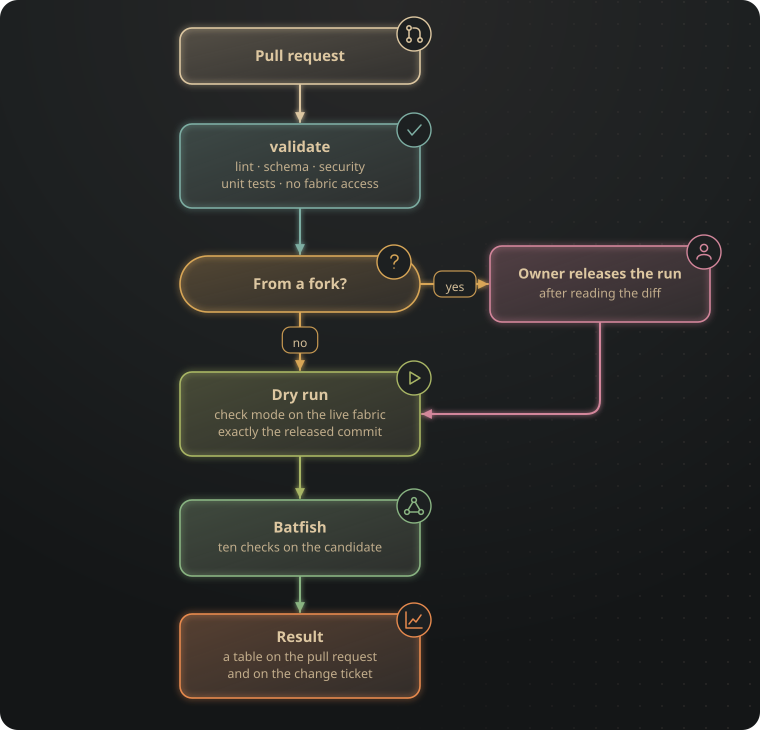
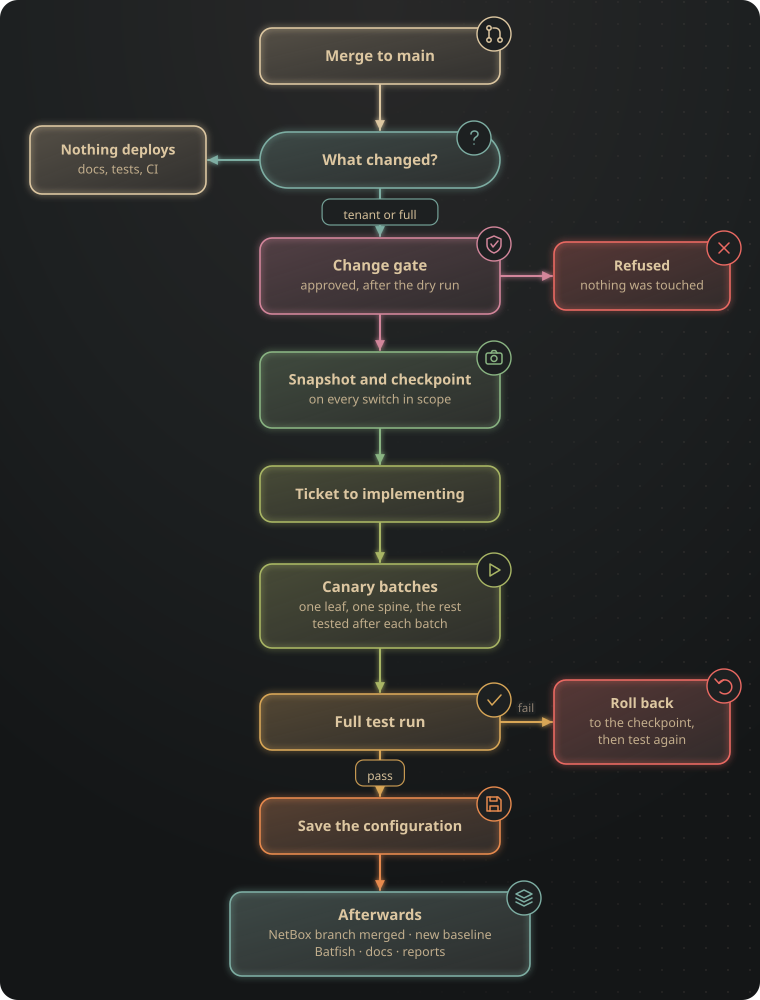

# The pipeline

[← Overview](../README.md)

Two pipelines: one for a pull request, which proves a change without making it, and one for a
merge, which makes it and proves it again. Both run on self-hosted runners with one signed
toolchain image.

## A pull request

  

### validate

The required check. It runs on a runner that has no switch key and no tokens, and needs no device:

| Stage | What it runs |
|---|---|
| Scope | Does the change touch the fabric at all? A change to another component skips the rest |
| Data model | yamllint, the JSON schema, the consistency rules (duplicate VNIs or VLANs, unknown VRFs, leak rules, timers, a pinned host key per switch) |
| Security | Dependency audit, static analysis with security rules, secret detection against a baseline, shellcheck, ansible-lint with its safety profile |
| Unit tests | The MCP server and the change gate's logic |

### The dry run

The full deploy, in Ansible check mode, against the live switches. It answers the only question
that matters before a merge: *which commands would each switch receive?*

The result is one comment on the pull request, rewritten on every push: a table of changes and
errors per switch, and Batfish's verdict. The commands themselves go to a private reports package,
not into the pull request.

| Host | Changes | Errors |
|---|---|---|
| leaf-101 | 1 | 0 |
| leaf-102 | 0 | 0 |
| leaf-103 | 0 | 0 |
| leaf-border-1 | 0 | 0 |
| … | | |

*The dry-run table of a one-line change: one command on one switch, nothing anywhere else.*

**Forks are held.** The dry run executes the pull request's own code with the key that can
configure the switches. So a pull request from a fork, which is how the agents work, runs nothing
until the owner has read the diff and released the run. The dry run then runs for exactly the
released commit; a later push needs a new release. Forks outside a short allow-list never reach a
runner at all.

### Batfish

Batfish builds a model of the network from configurations and answers questions about it without
any device. Here it gets the *candidate*: the running configurations with the dry run's commands
applied. Ten checks:

- every leaf-spine OSPF adjacency and BGP EVPN session comes up;
- the border's eBGP sessions come up, one per external tenant;
- each L2VNI is where the model says, with its VLAN and multicast group, and nowhere else;
- each L3VNI is on every leaf; each gateway is in the right VRF with the right address;
- the external router receives exactly the external tenants' networks and nothing internal;
- the border leafs learn the default route;
- no undefined references, no unparsed lines beyond a known list.

A failed check fails the job, and the change gate later refuses a merge whose dry run did not
pass all of them.

## A merge

  

| Step | What it does | If it fails |
|---|---|---|
| Deploy decision | Maps the changed files to *tenant*, *full* or *none* | No usable base commit means *full* |
| **Change gate** | Requires a `Change: #n` trailer, the ticket approved by the owner, an error-free dry run of the merged change with Batfish passed, and the approval later than that dry run | The job stops before anything touches a switch |
| Snapshot | Learns the operational state (BGP, OSPF, VXLAN, interfaces, routing) | |
| **Checkpoint** | An NX-OS checkpoint on every switch to be touched | No checkpoint, no deploy |
| Ticket | Moves the change ticket to *implementing*, with the pipeline's own account | Reported; never stops a deploy |
| **Canary** | Deploys in batches without saving: one leaf first, then (for *full*) one spine, then the rest. Each batch is tested, including pings from the lab hosts through the half-changed fabric | The first failing batch stops the rollout |
| Tests | The full pyATS run | Rollback |
| Save | Writes the startup configuration; keeps the three newest checkpoints | |
| **Rollback** | An atomic rollback to the checkpoint on every switch that differs from it, read back, then the tests again | A failed rollback is never retried: it alarms and waits for a person |
| Record | Merges the change's NetBox branch | Reported; never fails the run |
| After | Snapshot diff, new baseline when the tests passed, Batfish on the live configurations, documentation regenerated and published, reports stored | |

A *full* deploy with canary takes about 28 minutes, most of it testing between batches; the dry
run about 7. A rollback on one switch takes about half a minute.

## The tests

Expectations are not written by hand. They are rendered from the data model, so a new network is
tested from the moment it is merged. The state is read with pyATS and Genie parsers.

| | What is checked |
|---|---|
| **Control plane** | EVPN neighbours established; each tenant VRF up and no VRF that should not exist; L2 and L3 VNIs up; the exact set of VTEP peers; route targets; the border's eBGP sessions per tenant; vPC health; CPU, memory and core files; the telemetry certificate |
| **Data plane** | From the lab hosts, over their consoles: the gateway answers; the outside is reachable; hosts of one tenant reach each other; a tenant reaches shared services; tenants do **not** reach each other; a host without external access does **not** get out |

Fourteen test cases, each looping over the switches or host pairs it applies to: 67 results in a
recent run.

## Between changes

| Workflow | When | What it does |
|---|---|---|
| **Continuous test and drift** | Twice a day | The full tests; a dependency audit; *configuration drift* (a dry run of `main`: any pending command means a switch differs from the model); *operational drift* (the learned state compared with the stored baseline, counters left out); Batfish. Quiet when all is well |
| **Rollback drill** | Monthly | On one leaf: checkpoint, a harmless change, rollback, proof that the change is gone, tests, and a dry run showing no difference |
| **Game day** | Monthly | One deliberate fault (a link, a spine, a border exit) with the convergence time measured, then undone and verified |
| **Reminders** | Weekly | Opens an issue for every operations task due within two weeks: rotations, updates, drills |

## What the pipeline leaves behind

| Artefact | Content |
|---|---|
| A comment on the pull request | The dry-run table and Batfish's verdict |
| Notes on the change ticket | The dry-run table, the start of the deploy, the report of the merge run |
| A reports package per run | Test results, the plan, drift and state diffs, configurations. Private |
| The baseline | The operational state the next drift check compares with |
| Wiki pages | Tenants, fabric and border, rendered from the data model after every successful deploy |

## Why it can be trusted

- **Code from a pull request never meets the switch key unreviewed.** Separate runners: one for
  pull requests with no secrets, one for deploys, one for image builds.
- **Pinned everything.** Actions by commit, Python dependencies by hash, the toolchain image by a
  tag that is a hash of its inputs, scanned and signed.
- **Secrets reach single steps**, on merge or manual runs only.
- **Fail closed.** The gate, the release check, the publishing of reports and the game-day guard
  all refuse when they cannot verify.

## Next

- [A worked example](example-add-a-network.md): one real change through both pipelines, with its artefacts
- [The change workflow](change-workflow.md): the ticket behind every deploy
- [Game days](game-days.md): changes the dry run could not judge, and what caught them
- [Operations](operations.md): the drills and the calendar
