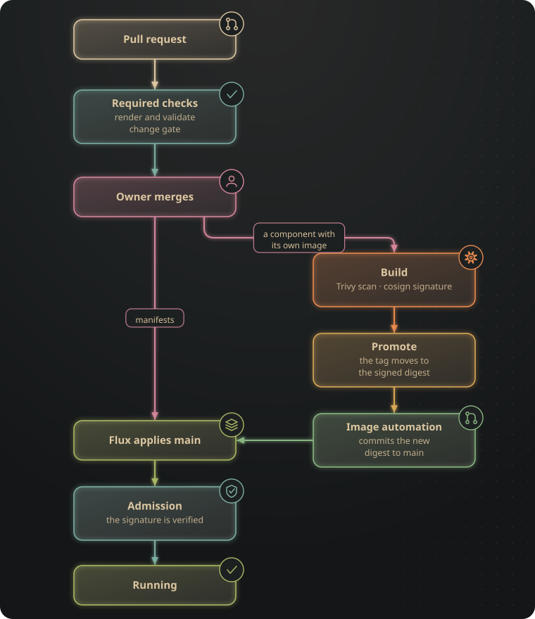

# The platform

[← Overview](../README.md)

Everything the fabric depends on (the forge, the runners, monitoring, tickets, NetBox, the status
page) runs on one small Kubernetes cluster that is itself managed as code. It is deliberately
modest: one node, sized for a lab, and built so that losing it loses nothing.

## The cluster

| | |
|---|---|
| Operating system | Talos Linux: immutable, no shell, configured through an API |
| Kubernetes | One node that is control plane and worker |
| Management | Omni, running off the cluster so it can rebuild the cluster |
| GitOps | Flux: the cluster applies what is in `main` and nothing else |
| Network | Cilium replacing kube-proxy, with load-balancer address management and the Gateway API |
| Ingress | One gateway, one route per application |
| Certificates | cert-manager with Let's Encrypt over DNS-01: a wildcard certificate, no application exposed for validation |
| Secrets | External Secrets Operator reading a Vault that runs elsewhere; nothing secret is in Git |
| Databases | CloudNativePG, one PostgreSQL instance per application |
| Storage | Local volumes on the node, with a retaining class for databases |
| Admission | The sigstore policy controller: only images with a valid signature start in the labelled namespaces |

## What runs on it

| Application | Purpose |
|---|---|
| **Forgejo** | The Git forge, its container registry and package registry |
| **Runners** | Four kinds, separated by what they may reach: pull requests (nothing), deploys (the switches), image builds (the registry), and one that only signs switch certificates (the forge and the vault) |
| **Monitoring** | Prometheus, Alertmanager, Grafana, the SNMP exporter |
| **Telemetry** | The gNMI collector and its time-series store |
| **Logging** | Logstash for the switches' syslog and traps, Elasticsearch, Loki and a collector for the platform's own logs |
| **Zammad** | Alarm tickets and change tickets, and the bridge that turns alarms into tickets |
| **NetBox** | The record of the fabric, with the branching plugin |
| **Mission Control** | The status page |
| **Sites** | The docs site and a blog |

Off the cluster, on purpose: the cluster's own management, the identity provider, the agents, the
secrets vault and the backups.

## From a merge to the cluster

  

- **Manifests**: a pull request is rendered and validated against the Kubernetes schemas. After
  the merge Flux applies it. Nobody runs `kubectl apply`.
- **Images**: an image built here is scanned, signed, and promoted by moving one tag to the signed
  digest. Flux notices the new digest and commits it to `main`, so the Git history says exactly
  which image ran when. A deployment is always pinned to a digest, never to a tag alone.
- **The only writer to `main` besides a merge** is that image automation, with a deploy key that
  can do nothing else.

## The platform's own change process

The platform has the same discipline as the fabric, with a lighter gate. A pull request that
changes cluster infrastructure, RBAC, network policies, chart or image versions needs an approved
change ticket named in its commits. The gate that checks this runs with the base branch's code
and a read-only token, so a pull request cannot rewrite its own gate. Documentation and
application content need no ticket.

Reviews are by the agents (the lead on every pull request, the engineer who owns the area); their
review is advice, and only the owner merges.

## Backups and recovery

| What | How | Kept |
|---|---|---|
| Databases | Continuous WAL archiving and a nightly base backup to an object store off the cluster | 14 days |
| Volumes | File-level backups, daily, weekly and monthly | 7 days to 6 months |
| Git | Push mirrors of every repository to a second machine | |
| Secrets | In the vault, which is backed up on its own | |

A restore drill is on the calendar every quarter: one database and one volume are restored into a
scratch namespace and checked.

## Security of the platform

- **Default-deny** network policies in every application namespace; each allowed flow is named.
- **One runner reaches the switches**, by name; no other pod has a route to the management network.
- **Least-privilege accounts** everywhere: a writer that cannot read, a reader that cannot write,
  tokens scoped to one job, a read-only registry pull token.
- **Pod security**: non-root, a seccomp profile, no service-account token unless a pod needs one.
- **The agents' cluster access**: read-only without secrets; one write (deleting a named pod),
  behind the owner's approval.

More in [Security](security.md).

## Why one node

High availability was not the goal; reproducibility was. The cluster replaced an earlier
single-host container setup in one day: the node was wiped, installed from the manifests in Git,
and each application's data came back from a dump. Every finding of that day was fixed in the
repository, so a reinstall follows the same steps. What must survive a rebuild (the management
plane, identity, secrets, backups, the agents) lives elsewhere.

## Next

- [Security](security.md)
- [Setup](setup.md): the order in which all of this is built
