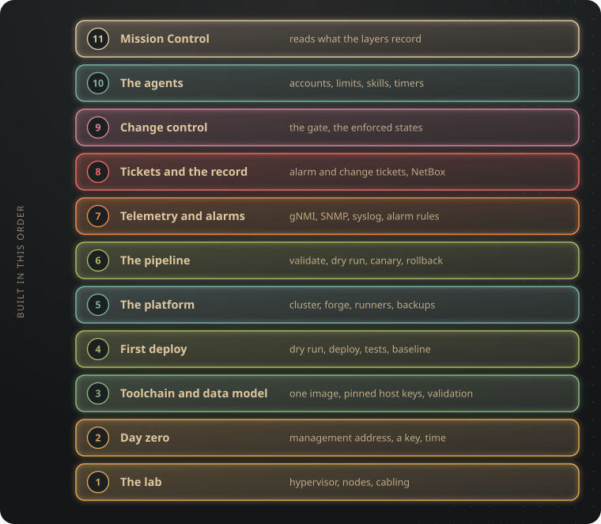
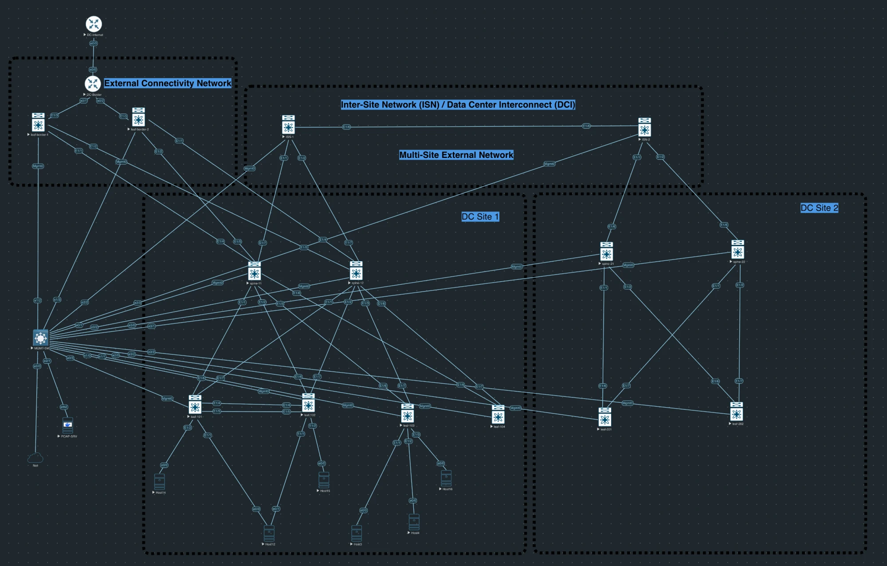

# Setup

[← Overview](../README.md)

How the environment is put together. The source is private, so this is not a tutorial to copy and
paste; it is the build order and the reasons, enough for someone who wants to build the same kind
of thing. Each layer needs the ones below it: the diagram reads from the bottom up, and the sections
follow in the same order.

  

## 1. The lab

| | |
|---|---|
| Hypervisor | EVE-NG Professional on a bare-metal server (8 cores, 128 GB of memory); the switches need nested virtualisation, and each is given 12 GB and uses about half of it |
| Nodes | Fourteen Nexus 9000v as KVM nodes: eight in DC-1, four in DC-2, two inter-site routers. An external router and the node behind it that stands for the internet, an out-of-band management switch and six hosts as lightweight IOS nodes. The POAP server as a container. Twenty-four in all |
| Cabling | Inside a site, every leaf to both spines; the vPC pair's peer link; DC-1's border leafs to the external router; each site's spines to its inter-site router, and the two inter-site routers to each other; every `mgmt0` to a port of its own on the management switch and from there to the lab network |
| Growth | The lab began as one site of seven switches. A new switch is started alone and watched until it answers: a booting 9000v keeps its processors busy for minutes, and several at once would starve the running fabric |
| Access | The web interface over HTTPS with a real certificate; consoles firewalled to named hosts |
| Care | Backed up before changes; patched by hand once a month with the lab stopped |

## 2. Day zero on each switch

Automation needs something to log in to. Every switch gets the same minimal start:

- its name and the NX-OS features of its role;
- the management VRF and the `mgmt0` address;
- an automation account with an SSH public key, and no password that works;
- NTP, so that logs and certificates make sense.

The first seven switches were given this by hand, as a short snippet each. Every switch since
has got it without anyone typing on it, through **POAP** (PowerOn Auto Provisioning): the fourth
leaf, the two inter-site routers and the four switches of DC-2.

| Step | What happens | Deploys |
|---|---|---|
| Declare | A pull request adds the switch to the data model, in a file of switches that are not yet part of the fabric. Validation covers it; the pipeline does not see it | nothing |
| Serve | The POAP server, a small container on the lab's management network, follows `main` and renders the switch's first configuration from the model within minutes | |
| Power on | An empty switch boots into POAP, asks for an address, fetches the script and finds its configuration by its serial number (in the lab, by the MAC address of `mgmt0`) | |
| Pin | A pull request pins the switch's SSH host key; validation refuses a switch without one | nothing |
| Enrol | A workflow run gives the switch its telemetry certificate ([Security](security.md#certificates-for-telemetry)) | |
| Join | A pull request moves the switch into the fabric's inventory, with the other end of its links. The ordinary pipeline does the rest: ticket, dry run, gate, checkpoint, deploy, tests | **full** |

The first configuration holds nothing confidential, so it can be served over plain TFTP on the
lab network: the accounts in it are locked, and the only key is a public one. One change ticket
covers the whole addition; only the join deploys, so only the join needs the approval. The join
deploys in one batch, without the canary: the canary leaf would be tested against a neighbour that
does not exist until the new switch and the spines are configured.

From day zero on, the switches are changed only through the data model. Two playbooks were run
once by hand before the first full deploy, because they must exist before the fabric can form:
the vPC peer link and the vPC access ports.

## 3. The toolchain and the data model

| Step | Result |
|---|---|
| Build the toolchain image | Ansible, pyATS, the Batfish client and the linters in one image, every dependency locked by hash; a wrapper runs each command in a fresh rootless container |
| Pin the switches' host keys | A `known_hosts` file in the repository; validation fails without a key for every switch |
| Write the inventory | The switches, their role groups and their site groups; one file per site for its AS, route reflectors and rendezvous point; one file per switch for links, loopbacks and ports |
| Write the tenants | VRFs, networks, VNIs, gateways, route leaking; checked by a JSON schema |
| Validate | Lint, schema and consistency rules, with no device access |

## 4. First deploy, tests, baseline

1. **Dry run** the whole fabric and read every command.
2. **Deploy** the full playbook: common settings and the underlay, SNMP and telemetry, login
   security, the border, then BGP and the overlay.
3. **Test** with pyATS: the control plane against expectations rendered from the model, then the
   data plane from the lab hosts.
4. **Store the baseline**: the learned operational state that later drift checks compare with.

At this point the fabric works and can be changed from a laptop. Everything after this exists so
that it does not have to be.

## 5. The platform

| Step | Result |
|---|---|
| Install the cluster | One Talos node, managed from outside the cluster |
| Bootstrap Flux | The cluster applies the `platform` directory of `main`: controllers first, then their configuration, then the forge, then the applications |
| Secrets | A vault off the cluster; the cluster reads it with a read-only token |
| The forge and its registry | Repositories, packages, container images |
| Runners | Separated by trust: pull requests, deploys, image builds; later a fourth that only signs switch certificates |
| Backups | Database archiving and volume backups to another machine, and a first restore drill |

## 6. The pipeline

1. `validate` as the required check on `main`, on the runner without secrets.
2. The dry run and Batfish on pull requests, on the deploy runner.
3. The merge pipeline: deploy decision, snapshot, checkpoint, canary, tests, save or rollback.
4. Branch protection: no direct pushes, only the owner merges, forks held until released.
5. The scheduled workflows: tests and drift twice a day, the drills, the reminders.

## 7. Telemetry and alarms

1. Enable gNMI on the switches, each with a certificate from the fabric's own certificate
   authority: an offline root, an issuing CA in the vault, and a workflow that enrols one switch
   per run.
2. Deploy the collector, the SNMP exporter, Prometheus and Grafana.
3. Send syslog and traps to Logstash and on to Elasticsearch.
4. Write the alarm rules, one runbook per subject.
5. Add the dead-man's switch for the monitoring itself.

## 8. Tickets and the record

| Step | Result |
|---|---|
| Zammad | A group for alarms and a group for changes; the change ticket's fields (kind, risk, deploy action, devices, pull request, rollback, verification) |
| The alarm bridge | Alarms open, annotate and close their tickets |
| NetBox | Devices, interfaces and cables; then tenants, VLANs, VNIs and addresses loaded from the data model through the first change ticket |
| NetBox branching | A change's NetBox edits live in a branch named after its ticket, merged by the pipeline after the tests pass |

## 9. Change control

1. The ticket states and the workflow rules that restrict each role, tested through the API.
2. Separate accounts and tokens: the gate (read-only), the pipeline (one state), the follow-up
   (one state back).
3. The change gate as a step of the merge pipeline, failing closed.
4. A first real change through the whole flow, with a deliberate deviation, before trusting it.

## 10. The agents

1. A host of their own, one operating-system user per agent, one forge and one ticket account
   each, with the narrowest role that works.
2. The read-only MCP server under a separate user, the only one with a route to the switches.
3. The chat bridge with approval buttons, and the approval hook.
4. The skills: the procedures as versioned text.
5. The timers: alarm triage, change follow-up, the daily digest.
6. An injection drill before giving them real work.

## 11. Mission Control

Built last, because it only reads what the other layers already record: one source per system,
each with a read-only account, tested against recorded answers, deployed like any other signed
image behind the identity provider.

## Afterwards: a second site

Not a twelfth layer: the second site and the inter-site network were built with the layers
above, which is the test of them. The design was written down and decided first; the six new
switches came in through POAP; DC-2 was deployed as a fabric of its own; then the spines of both
sites became border gateways, DC-2's first and DC-1's one at a time. The order and the reasons are
on the page about [Multi-Site](multisite.md).

## What it takes

| | |
|---|---|
| Hardware | One server for the lab (fourteen virtual switches were estimated at about 85 GB of memory), one small machine for the cluster, a Raspberry Pi, a storage box |
| Licences | The hypervisor's professional edition and the vendor's virtual switch image; everything else is open source |
| Effort | The fabric and its first deploy are the small part. The pipeline, the gate and the discipline around them are the real work |

## Next

- [Architecture](architecture.md): the same components, as they run
- [Multi-Site](multisite.md): how the second site was added
- [Operations](operations.md): what keeps running after the build
